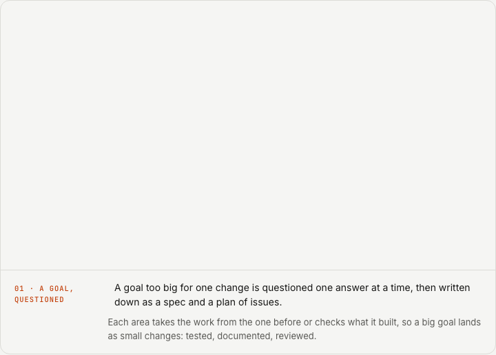

# Agentic Engineering _(agentic-engineering)_

One Claude Code plugin, `agentcraft`: thirteen fixes for problems that keep turning up when engineering with agents.

<picture>
  <source media="(prefers-color-scheme: dark)" srcset="docs/assets/banner.dark.gif">
  
</picture>

Each area solves a problem I kept hitting, from code written before the spec
was settled to drafts that ship in someone else's voice. The premise: agents
didn't make the fundamentals optional. They made them enforceable.

## Install

```text
/plugin marketplace add NCMcClure/agentic-engineering
/plugin install agentcraft@agentic-engineering
```

Coming from the separate plugins? The catalog no longer lists them, so they
do not update into this one. Install `agentcraft` by name, then remove each
old one with `/plugin uninstall <old-name>@agentic-engineering`.

## Usage

Type `/agentcraft:start-here`, or ask for the work in plain words. It is the
only entry in the slash menu: it asks what you want to do, explains the area
that does it, and hands off. Given a task, it asks nothing and names the route
that fits.

The areas are not a pile of tools. A goal too big for one change gets
questioned into a spec and a plan, each issue runs as a card in a session of
its own, and the change that comes out is tested first, judged by eye where
that matters, documented in the same change, reviewed, and landed. Each area
names the next one, so nobody has to remember the step.

<picture>
  <source media="(prefers-color-scheme: dark)" srcset="docs/assets/goal-to-main.dark.gif">
  
</picture>

## The areas

| Area | Use it to |
|---|---|
| [agent-works](docs/areas.md#agent-works) | run several tasks at once as child sessions from a kanban board |
| [agentic-teamwork](docs/areas.md#agentic-teamwork) | hold a repo to its git conventions, then ship and land a change |
| [but-first-planning](docs/areas.md#but-first-planning) | turn an idea into a spec, a backlog, and issues built test-first |
| [code-diet](docs/areas.md#code-diet) | keep new code at the simplest rung that holds, and cut the rest |
| [codebase-optimizer](docs/areas.md#codebase-optimizer) | restructure a codebase that has grown messy, behind its own tests |
| [context-doctor](docs/areas.md#context-doctor) | read a session's transcript for what went wrong with its context |
| [docs-parity](docs/areas.md#docs-parity) | keep user docs, screenshots and the README level with the code |
| [perceptual-loop](docs/areas.md#perceptual-loop) | check work judged by eye or ear with shots, gates and a real look |
| [picture-this](docs/areas.md#picture-this) | draw how something works as an animated figure |
| [plugin-workbench](docs/areas.md#plugin-workbench) | make, score, and fix a plugin against one rubric |
| [system-map](docs/areas.md#system-map) | keep a system map the code checks, and draw it on a Miro board |
| [workflow-studio](docs/areas.md#workflow-studio) | build a Claude Code workflow on a canvas or by hand |
| [write-like-me](docs/areas.md#write-like-me) | write prose in your own voice, free of AI tells |

Each one, with a picture of how it works: [docs/areas.md](docs/areas.md).
Every route on one page: [docs/plugins.md](docs/plugins.md).

An area is something a model calls, with a route as the first word of its
arguments, and a route is a document the area reads. It costs the skill
listing nothing until it is taken.

<picture>
  <source media="(prefers-color-scheme: dark)" srcset="docs/assets/routes-behind-names.dark.gif">
  
</picture>

## Contributing

[CONTRIBUTING.md](CONTRIBUTING.md) has the dev loop, the rules a change is
held to, and what to run before a commit. `npm run validate` and `npm test`
are what CI runs on every push.

## License

MIT; see [LICENSE](LICENSE).
