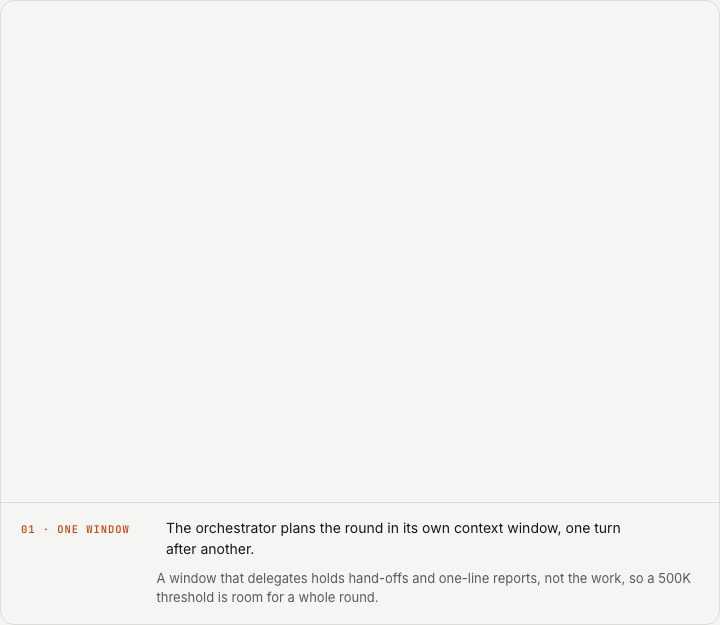
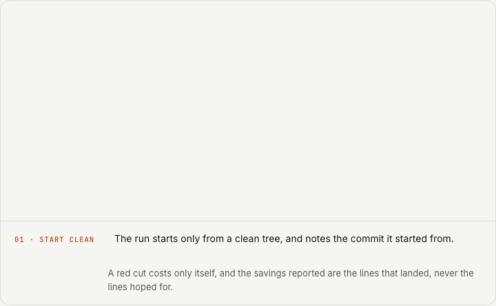
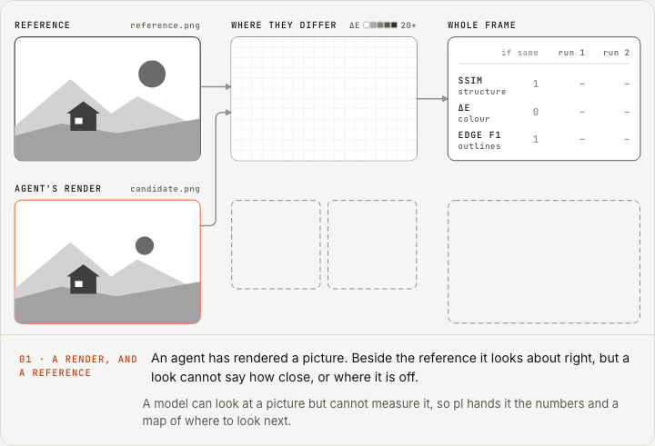
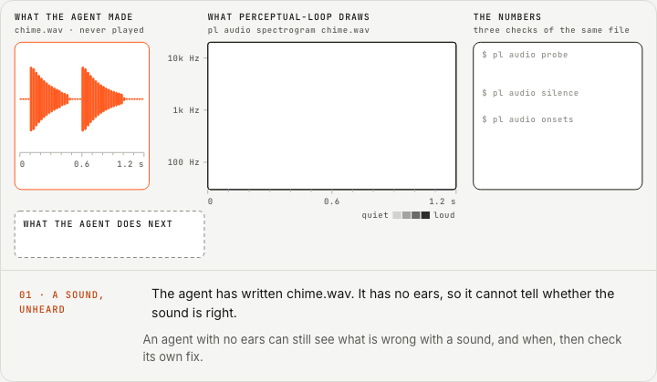
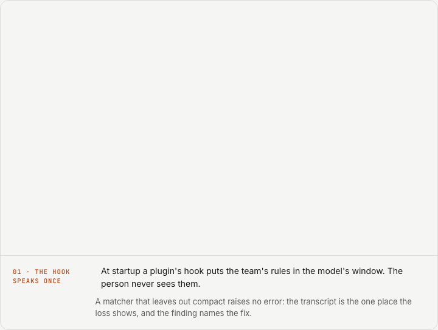

<picture>
  <source media="(prefers-color-scheme: dark)" srcset="docs/assets/banner.dark.gif">
  
</picture>

# Agentic Engineering

Agents can write the code. What they don't do on their own is keep a project
something you can scale, maintain, understand, and hand to a user. `agentic-engineering`
is one Claude Code plugin whose eight areas each hold one of those lines, so
what an agent ships is software you would have signed off on.

**It scales.** [planning](#planning) settles what is being built before
anyone builds it. [agents](#agents) runs many pieces of that work in
parallel without sessions stepping on each other or starving your machine of
the compute a test-heavy build needs. [delivery](#delivery) holds every
contributor's agents to the same standards, so a team can grow and still move
fast in one direction.

**You can still follow it.** People no longer read every line an agent
writes, so the understanding has to live somewhere they will look.
[docs](#docs) moves the user docs in the same change as the code, draws the
system map from the code itself, and turns a mechanism into an animated
figure a stakeholder understands at a glance. You always know what changed
and how it works, and so do the people using it.

**It is good, not only finished.** A great deal of what makes software usable
is judged by eye or ear: an interface, a render, an animation, a sound.
[design](#design) gives an agent a way to iterate on exactly that, and holds
every front end to the design system you already have.
[code](#code) keeps the code small and its structure sound as it grows.

**It sounds like you, and it compounds.** [writing](#writing) runs through
all of it: docs, specs, figures and copy come out in one voice, yours.
[harness](#harness) is the work on the agent's own surroundings: it keeps a
repo's instructions and guard rails in order, shows why a session went wrong,
and turns something you worked out with an agent into a plugin held to a
standard, so the next project starts ahead.

No single area is the point. Each closes one way a project built with agents
goes wrong, and the sum is a project that reaches the goal you set for it.

> The premise: agents didn't make the fundamentals optional.
> They made them necessary.

## Install

```text
/plugin marketplace add NCMcClure/agentic-engineering
/plugin install agentic-engineering@agentic-engineering
```

Then type `/agentic-engineering:start-here`, or just ask for the work in words.

Coming from the separate plugins? The catalog no longer lists them, so they
do not update into this one. Install `agentic-engineering` by name, then remove each
old one with `/plugin uninstall <old-name>@agentic-engineering`.

Coming from 1.x, when the plugin was named `agentcraft`? Install this one and
open a session before you run `/plugin uninstall agentcraft@agentic-engineering`:
the uninstall deletes that plugin's data directory, and each area copies what it
kept there the first time it runs. Your `userConfig` values do not carry over.

## How the areas work together

The areas are not a pile of tools. A goal too big for one change gets
questioned into a spec and a plan, each issue runs as a card in a session of
its own, and the change that comes out is tested first, judged by eye where
that matters, documented in the same change, written in your voice, reviewed,
and landed. Each area names the next one, so nobody has to remember the step.

<picture>
  <source media="(prefers-color-scheme: dark)" srcset="docs/assets/goal-to-main.dark.gif">
  
</picture>

<sub>One goal, three issues, three sessions. Every hand-off drawn here is a line in one area that names another.</sub>

## The areas

There used to be twelve plugins here, listing about eighty skills between
them, and a job does not say which one it needs. Now there is one thing to
remember. `/agentic-engineering:start-here` asks what you want to do, explains the
area that does it, and hands off to the route that does the work. Given a
task, or run where nobody can answer, it asks nothing and names the route
that fits.

An area is a kind of work, not a tool: planning, agents, delivery, code,
design, docs, writing, harness. So a new route has an obvious home, and the
list stays eight names long as the plugin grows.

It is the only entry in the slash menu. An area is something an agent calls,
with a route as the first word of its arguments, and a route is a document
the area reads, so it costs the skill listing nothing until it is taken. You
ask for the work in words and the agent picks the area.

<picture>
  <source media="(prefers-color-scheme: dark)" srcset="docs/assets/routes-behind-names.dark.gif">
  
</picture>

<sub>Nine names are listed. The 78 routes behind them stay on disk until an area reads one.</sub>

### planning

Code written before the spec is settled is a loan against your future self.
A planning pipeline (spec → grill → architect → plan → publish) plus a build
loop of coordinated TDD agents, all landing in a workspace: `.agents/plan/` for
the project, `.agents/plans/<name>/` for one feature or long task. An autopilot
runs the whole graph hands-off. The backlog publishes
to GitHub or GitLab, and one script owns every status change so the plan and
the tracker cannot disagree quietly. `grill` stands outside the pipeline: it
questions any vague ask, one question at a time, until nothing is left unsaid.
[Read more →](plugins/agentic-engineering/skills/planning/README.md)

<picture>
  <source media="(prefers-color-scheme: dark)" srcset="plugins/agentic-engineering/skills/planning/assets/figures/folders-climb.dark.gif">
  
</picture>

<sub>A status is set in one place and derived everywhere else.</sub>

<picture>
  <source media="(prefers-color-scheme: dark)" srcset="plugins/agentic-engineering/skills/planning/assets/screens/spec-site.dark.png">
  
</picture>

<picture>
  <source media="(prefers-color-scheme: dark)" srcset="plugins/agentic-engineering/skills/planning/assets/screens/plan-view.dark.png">
  
</picture>

<sub>The spec site and its plan view.</sub>

### agents

Two sessions on one machine never learn the other exists, and task status
ends up in six places. Tasks and owed checks live on a kanban board every
worktree shares; `orchestrate` runs a large goal from it in parallel, each
card in its own worktree, approved by you, reviewed, and landed on green. A
subagent builds each card unless you ask for sessions. Locks, leases, notes
and learnings let sessions across projects share one machine: a dev-server
port, a simulator or a GPU is held by one of them at a time. Node 22, nothing
else.
[Read more →](plugins/agentic-engineering/skills/agents/README.md)

<picture>
  <source media="(prefers-color-scheme: dark)" srcset="plugins/agentic-engineering/skills/agents/assets/figures/one-window.dark.gif">
  
</picture>

<sub>One orchestrator window carries a whole round: it holds hand-offs and one-line reports, not the work.</sub>

### delivery

Mixed-skill teams shouldn't rely on discipline to keep prototypes off main.
A repo opts in with one committed file, and from then on session hooks judge
every commit and push the way a shell would read it: protected branches, force
pushes, `--no-verify`, credentials and junk are refused, and a push asks first.
A pre-commit hook covers the terminal and a CI gate backs both. Routes scaffold
a repo, ship and land a change on GitHub or GitLab, and keep tests honest; a
hard test gate is one opt-in away. It owns the team's version-control
conventions; how agents share a machine is the agents area's job.
[Read more →](plugins/agentic-engineering/skills/delivery/README.md)

<picture>
  <source media="(prefers-color-scheme: dark)" srcset="plugins/agentic-engineering/skills/delivery/assets/figures/four-commands-one-answer.dark.gif">
  
</picture>

<sub>Each git call in a shell line is judged where it really runs, and one deny stops the line.</sub>

### code

Every line an agent writes gets paid for more than once: at generation, at
review, and in every future session that loads it as context. So the agent
builds at the lowest rung that works (a 7-rung ladder with hard safety
carve-outs, kept in context as one line), checks what already exists before
building, reviews diffs with script-located candidates and cuts applied
behind validate-or-revert, and tracks every deliberate shortcut as a `debt:`
marker with an expiry trigger. The ladder evolved from the MIT-licensed
ponytail plugin; borrowed stays labeled as borrowed.

<picture>
  <source media="(prefers-color-scheme: dark)" srcset="plugins/agentic-engineering/skills/code/assets/figures/cut-by-cut.dark.gif">
  
</picture>

<sub>A cut that turns a check red costs only itself, and the report counts the lines that landed.</sub>

For a repo that has already accreted, the same area restructures it in
stages, in whatever language it speaks (Python, JS/TS, Go, and Rust are
detected out of the box). It organizes the file tree into a layout of
orientation hubs an agent reads before descending, splits god-files, and
deepens shallow architecture. Nothing moves until you have seen the plan,
every change sits behind CI-faithful validation with revert-on-red, and
nothing is ever pushed.
[Read more →](plugins/agentic-engineering/skills/code/README.md)

<picture>
  <source media="(prefers-color-scheme: dark)" srcset="plugins/agentic-engineering/skills/code/assets/figures/drifted-to-organized.dark.gif">
  
</picture>

<sub>One small repo, stage by stage: the plan first, the tree tidied, a red change put back, the long file split.</sub>

<picture>
  <source media="(prefers-color-scheme: dark)" srcset="plugins/agentic-engineering/skills/code/assets/screens/report.dark.png">
  
</picture>

<sub>The architecture report, written about this repo's own tooling.</sub>

### design

An agent can't iterate on what it can't measure. For work judged by eye or ear
(a render, a UI, a clip, a sound) the area supplies the loop code already has:
reproducible shots, numbers that gate regressions against measured noise,
sheets the agent opens with its own vision, and one review page that batches
the taste questions for you. One Node CLI does the measuring, a hook keeps
runs small, and a blind critic judges a picture without being told what it was
meant to be. Defects are the agent's to fix; taste is yours to decide.

A front end has one more way to go wrong: it drifts from the design system,
one hand-set corner and one raw colour at a time. You name your system once,
by a folder or a GitHub repo and a tag, and each repo with a web front end
adopts it: the kit installed at that tag, a committed pin, the system's rules
copied beside it, and a one-file checker that fails on a raw colour or a
banned class. Fixes come from the system's own tokens and components, and an
exception needs a reason and your yes.
[Read more →](plugins/agentic-engineering/skills/design/README.md)

<picture>
  <source media="(prefers-color-scheme: dark)" srcset="plugins/agentic-engineering/skills/design/assets/figures/toward-a-reference.dark.gif">
  
</picture>

<sub>A still against its reference: where they differ, drawn as a map, and the marked place enlarged and scored by itself.</sub>

<picture>
  <source media="(prefers-color-scheme: dark)" srcset="plugins/agentic-engineering/skills/design/assets/figures/motion-between-frames.dark.gif">
  
</picture>

<sub>Motion: the frame whose step stands out, the frames round it, and which way things moved between them.</sub>

<picture>
  <source media="(prefers-color-scheme: dark)" srcset="plugins/agentic-engineering/skills/design/assets/figures/sound-you-can-see.dark.gif">
  
</picture>

<sub>Sound: a click the agent cannot hear, standing as a tall line in the picture and named by its time.</sub>

<picture>
  <source media="(prefers-color-scheme: dark)" srcset="plugins/agentic-engineering/skills/design/assets/screens/review.dark.png">
  
</picture>

<sub>The review page.</sub>

### docs

User docs drift because they ship after the code. Here they are part of the
change: the commit that moves a button rewrites the page and retakes the
screenshot, through a writer contract (audiences, a page shape, grounded
claims) and a capture harness that makes every picture from the built product
deterministically, for web, desktop, CLI, Unreal, Qt or mobile. One checker
maps code to pages and finds missing, stale and broken docs, telling the
agent in session and failing in CI, for a site, a `docs/` folder, a wiki or a
README. A README check keeps the front page written for people.

<picture>
  <source media="(prefers-color-scheme: dark)" srcset="plugins/agentic-engineering/skills/docs/assets/figures/docs-move-with-code.dark.gif">
  
</picture>

<sub>The code changes, so the page is rewritten and the screenshot retaken, in the same change.</sub>

An architecture diagram is true on the day it is drawn, so the system map
moves into the code: each module declares what it is and whom it calls in
`@system` comment lines, the map is extracted from them into a diffable file
committed beside the code, and a checker holds it to the real import graph. A
module or a call nobody declared fails the check instead of quietly dating
the picture. Miro is where the map is drawn: generators put it, or any other
frame, on a board through a lint that refuses overlaps and crossed
connectors, a live check of what Miro actually drew, and a pull that keeps
layout changes made on the board. It holds no credentials: publishing goes
through the Miro MCP you connect.

<picture>
  <source media="(prefers-color-scheme: dark)" srcset="plugins/agentic-engineering/skills/docs/assets/figures/map-true-to-code.dark.gif">
  
</picture>

<sub>A comment line draws a box or an arrow. An import nobody declared fails the check until the map is brought level.</sub>

A system that takes three paragraphs to explain usually takes one good
picture. Describe how something works, or point at a feature in your
codebase, and get three rough animated drafts to choose from, each a
different picture designed from that subject and not from a template. The one
you pick becomes a React component that embeds in MDX, with light and dark
stills for a plain README.
[Read more →](plugins/agentic-engineering/skills/docs/README.md)

<picture>
  <source media="(prefers-color-scheme: dark)" srcset="docs/assets/iso-flow.dark.gif">
  
</picture>

<sub>The area's worked example, filmed by the area. Every other figure on this page was drawn the same way, and so was the banner.</sub>

### writing

Everything an agent drafts for you ships in someone else's voice. A
calibrated, tightly line-budgeted profile of how *you* write auto-loads into
every session, routes audit text for AI tells by hunting clusters of
co-occurring patterns rather than lone buzzwords, and reflective hooks fold
your style feedback back into the profile.
Prose only: code and commit messages stay out of scope.
[Read more →](plugins/agentic-engineering/skills/writing/README.md)

<picture>
  <source media="(prefers-color-scheme: dark)" srcset="plugins/agentic-engineering/skills/writing/assets/figures/profile-page-revised.dark.gif">
  
</picture>

<sub>One remark about your style becomes a line in the profile every later session loads.</sub>

### harness

The work on an agent's own surroundings: what it is told, what it may do, and
the plugins and workflows it runs.

Agent instructions rot the same way in every repo: `AGENTS.md` bloats and one
rule gets stated four times. Every kind of fact gets one home under `.agents/`
with a size budget (memory, decisions, a hub per directory), a guard stops the
mistakes agents repeat, and `aw doctor` checks all of it.

<picture>
  <source media="(prefers-color-scheme: dark)" srcset="plugins/agentic-engineering/skills/agents/assets/screens/doctor.dark.png">
  
</picture>

<sub><code>aw doctor</code>, run on this repo.</sub>

Hooks are invisible from both ends: you never see a session-start briefing,
and the agent cannot tell which of its context came from where, or what came
back after a compaction. Claude Code records all of it in the session
transcript, and the lens reads it back: each hook's output and who saw it,
which skills kept their description in the listing, the size of every
request, and what a compaction threw away. Then it names what went wrong,
each finding with the fix.

<picture>
  <source media="(prefers-color-scheme: dark)" srcset="plugins/agentic-engineering/skills/harness/assets/figures/lost-at-compaction.dark.gif">
  
</picture>

<sub>Nothing fails when a rule is lost at a compaction. The transcript is where it shows.</sub>

<picture>
  <source media="(prefers-color-scheme: dark)" srcset="plugins/agentic-engineering/skills/harness/assets/screens/context-lens.dark.png">
  
</picture>

<sub>The lens reading a synthetic session.</sub>

A plugin's true cost is invisible until it's installed, and authoring a good
one means guessing at standards nobody wrote down. One rubric covers both
halves: `plugin-create` interviews you, scaffolds the layout, and authors
against the six evaluation dimensions; `plugin-evaluate` scores any path or
git URL into an HTML scorecard with an adopt/rework verdict;
`plugin-improve` applies the fixes ranked by how many points each one buys
back.

<picture>
  <source media="(prefers-color-scheme: dark)" srcset="plugins/agentic-engineering/skills/harness/assets/figures/ledger-to-verdict.dark.gif">
  
</picture>

<sub>Every number on the scorecard is the script's.</sub>

<picture>
  <source media="(prefers-color-scheme: dark)" srcset="plugins/agentic-engineering/skills/harness/assets/screens/scorecard.dark.png">
  
</picture>

<sub>A scorecard.</sub>

Claude Code dynamic workflows are programs; you should be able to see them.
A node canvas compiles graphs to runnable `.claude/workflows/*.js` and
round-trips them back, and a route covers hand-authoring without the GUI.
[Read more →](plugins/agentic-engineering/skills/harness/README.md)

<picture>
  <source media="(prefers-color-scheme: dark)" srcset="plugins/agentic-engineering/skills/harness/assets/figures/two-folders.dark.gif">
  
</picture>

<sub>The graph file is the one truth, and nothing Claude Code runs changes until you publish.</sub>

<picture>
  <source media="(prefers-color-scheme: dark)" srcset="plugins/agentic-engineering/skills/harness/assets/screens/canvas.dark.png">
  
</picture>

<sub>The canvas.</sub>

Every area and route on one page: [docs/plugins.md](docs/plugins.md).

## Working in this repo

The contribution contract (layout invariants, the versioning rule, how to
add or change an area or a route) lives in [.agents/rules/dev-rules.md](.agents/rules/dev-rules.md).
`npm run validate` checks the enforceable parts and `npm test` runs every hook;
CI runs both on every push. Agents maintaining this repo read the same rules
you do, and [CONTRIBUTING.md](CONTRIBUTING.md) has the dev loop.

## License

MIT; see [LICENSE](LICENSE).
