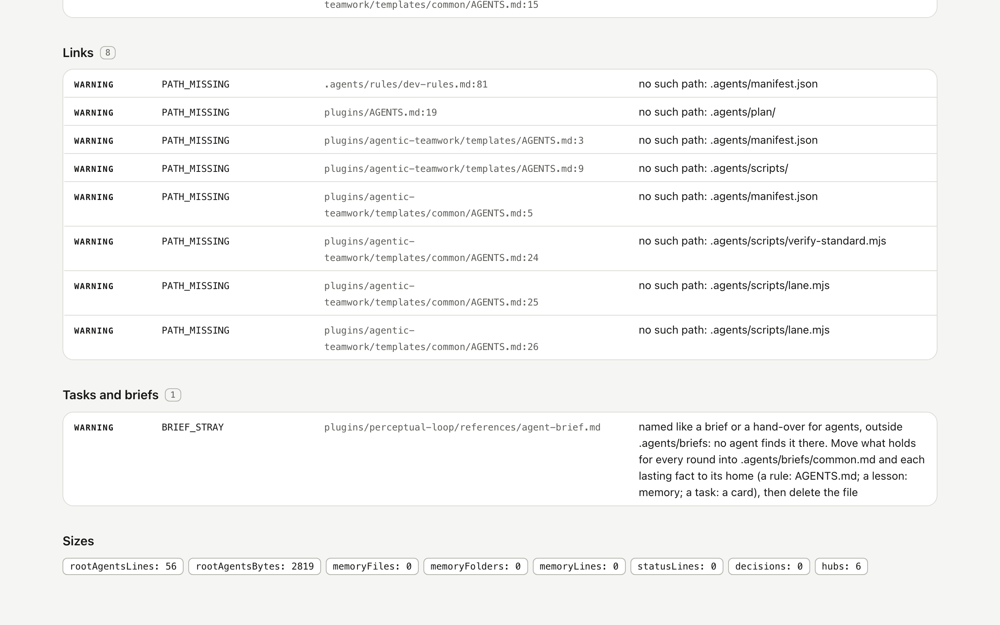
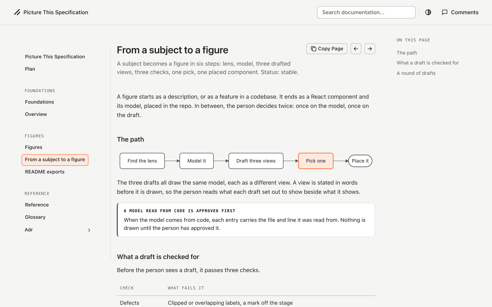
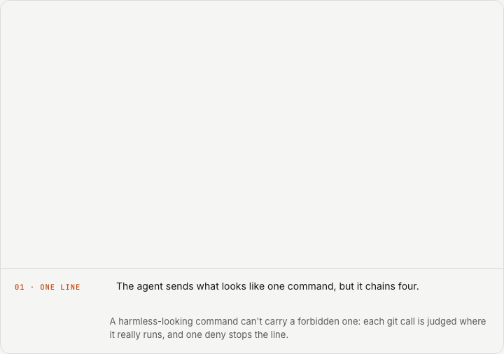
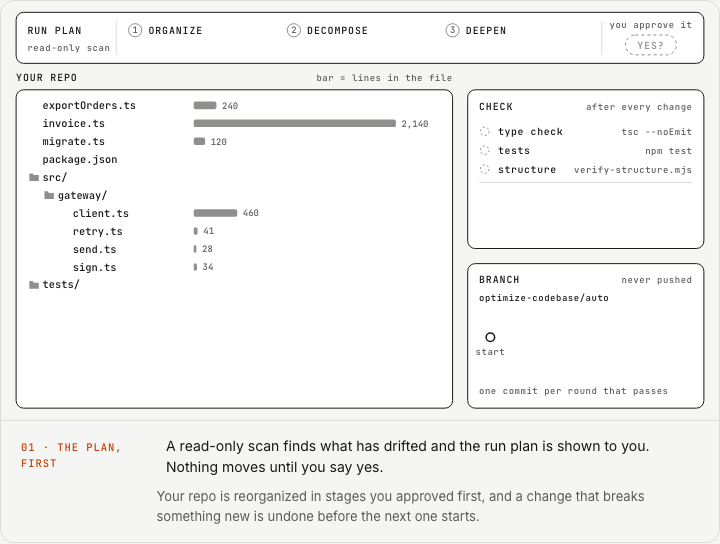
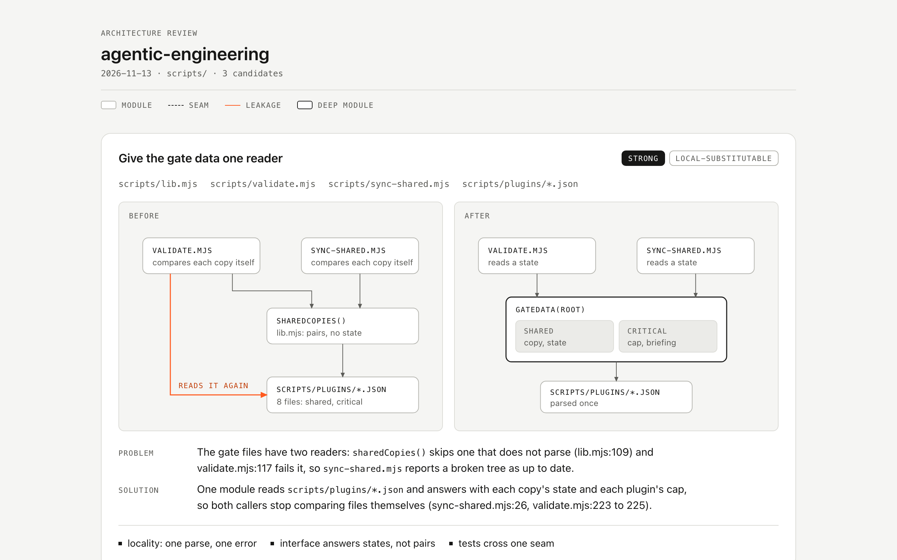
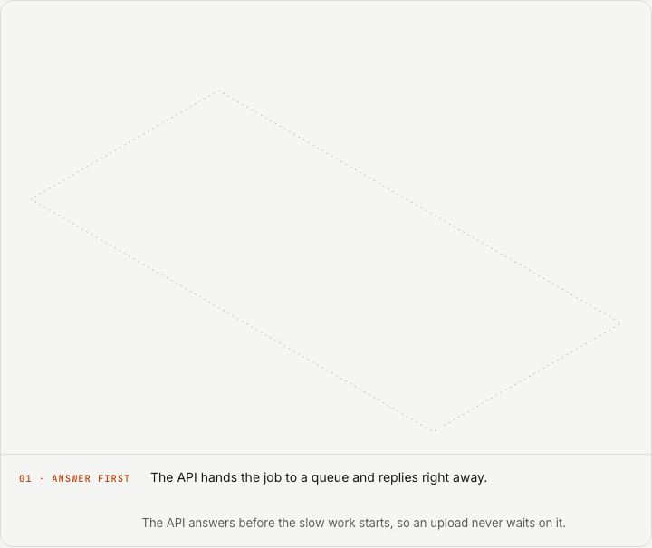
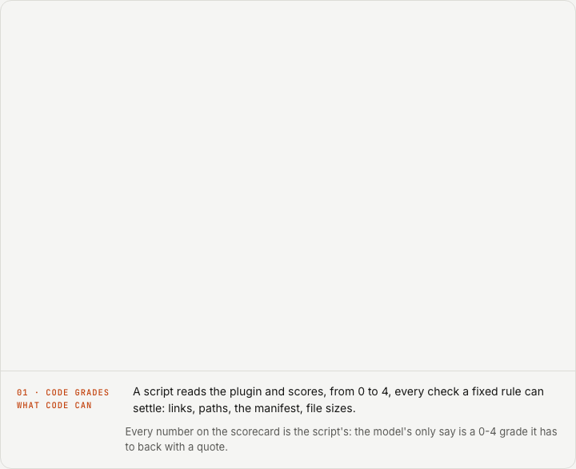
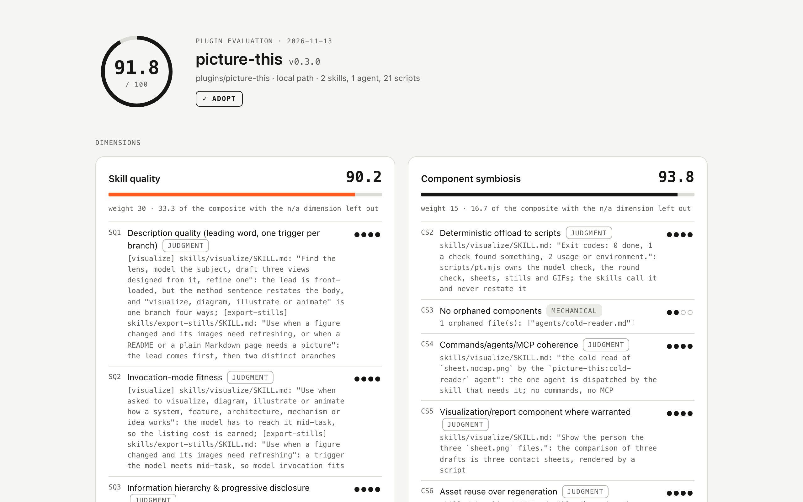
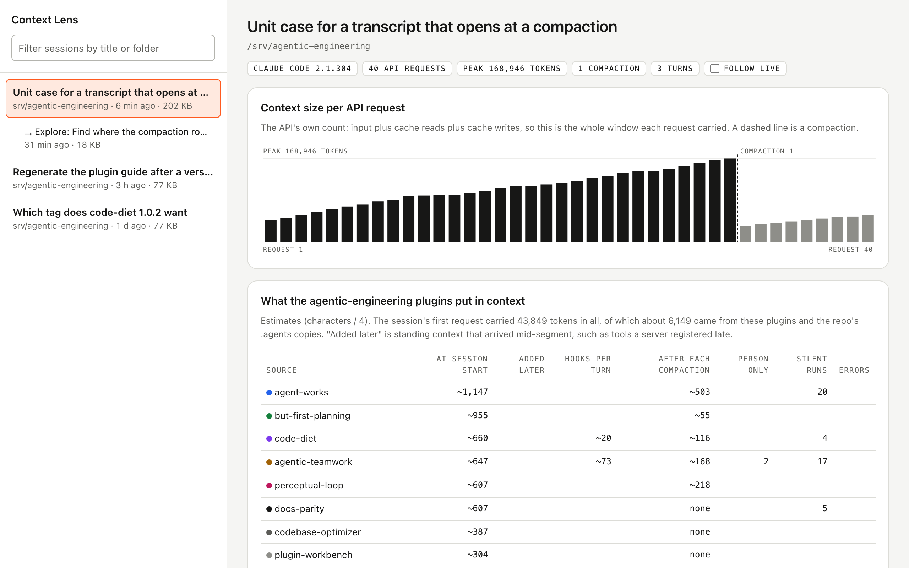
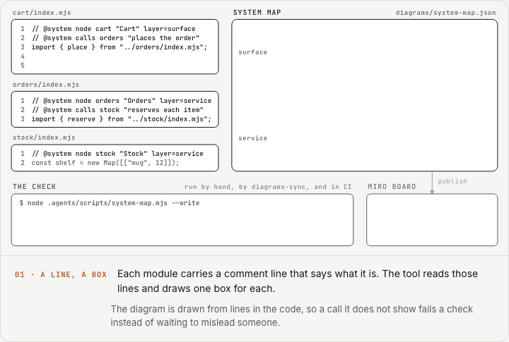

<picture>
  <source media="(prefers-color-scheme: dark)" srcset="docs/assets/banner.dark.gif">
  
</picture>

# Agentic Engineering

A personal marketplace of Claude Code plugins. Each one solves a problem
I kept hitting while engineering with agents, from code getting written
before the spec was settled to drafts that ship in someone else's voice.

> The premise: agents didn't make the fundamentals optional.
> They made them enforceable.

## Install

Add the marketplace once:

```text
/plugin marketplace add NCMcClure/agentic-engineering
```

Then install whichever plugins you want:

```text
/plugin install but-first-planning@agentic-engineering
```

Skills arrive namespaced: `/but-first-planning:spec-init`,
`/agentic-teamwork:bootstrap`, and so on.

## The plugins

### agent-works

Agent workflows rot the same way in every repo: `AGENTS.md` bloats, one rule
gets stated four times, task status lives in six places, and two sessions on
one machine never learn the other exists. agent-works gives every kind of fact
one home under `.agents/` with a size budget and checks them all with
`aw doctor`. Tasks and owed gates live on a kanban board every worktree
shares; `/agent-works:orchestrate` runs a large goal from it as child sessions
in their own worktrees, each approved by you, reviewed, and landed on green. A
guard stops the mistakes agents repeat, and locks, leases, notes and learnings
let sessions across projects share one machine. Node 22, nothing else. It is
the foundation the plugins below lean on; each still runs without it.
[Read more →](plugins/agent-works/README.md)

<picture>
  <source media="(prefers-color-scheme: dark)" srcset="plugins/agent-works/assets/figures/one-window.dark.gif">
  
</picture>

<sub>One orchestrator window carries a whole round: it holds hand-offs and one-line reports, not the work.</sub>

<picture>
  <source media="(prefers-color-scheme: dark)" srcset="plugins/agent-works/assets/screens/doctor.dark.png">
  
</picture>

<sub><code>aw doctor</code>, run on this repo.</sub>

### but-first-planning

Code written before the spec is settled is a loan against your future self.
A planning pipeline (spec → grill → architect → plan → publish) plus a build
loop of coordinated TDD agents, all landing in one `.agents/plan/` workspace,
with an autopilot that runs the whole graph hands-off. The backlog publishes
to GitHub or GitLab, and one script owns every status change so the plan and
the tracker cannot disagree quietly.
[Read more →](plugins/but-first-planning/README.md)

<picture>
  <source media="(prefers-color-scheme: dark)" srcset="plugins/but-first-planning/assets/figures/folders-climb.dark.gif">
  
</picture>

<sub>A status is set in one place and derived everywhere else.</sub>

<picture>
  <source media="(prefers-color-scheme: dark)" srcset="plugins/but-first-planning/assets/screens/spec-site.dark.png">
  
</picture>

<picture>
  <source media="(prefers-color-scheme: dark)" srcset="plugins/but-first-planning/assets/screens/plan-view.dark.png">
  
</picture>

<sub>The spec site and its plan view.</sub>

### agentic-teamwork

Mixed-skill teams shouldn't rely on discipline to keep prototypes off main.
A repo opts in with one committed file, and from then on session hooks judge
every commit and push the way a shell would read it: protected branches, force
pushes, `--no-verify`, credentials and junk are refused, and a push asks first.
A pre-commit hook covers the terminal and a CI gate backs both. Skills scaffold
a repo, ship and land a change on GitHub or GitLab, and keep tests honest; a
hard test gate is one opt-in away. Owns team version-control conventions; how
agents share a codebase is agent-works' job. The two are meant to run together.
[Read more →](plugins/agentic-teamwork/README.md)

<picture>
  <source media="(prefers-color-scheme: dark)" srcset="plugins/agentic-teamwork/assets/figures/four-commands-one-answer.dark.gif">
  
</picture>

<sub>Each git call in a shell line is judged where it really runs, and one deny stops the line.</sub>

### codebase-optimizer

A staged, autonomous optimizer for whatever language your repo speaks
(Python, JS/TS, Go, and Rust are detected out of the box). It organizes the
file tree into an AGENTS.md-hubbed progressive-disclosure layout (orientation
hubs an agent reads before descending), decomposes god-files, and deepens
shallow architecture. Nothing moves until you have seen the plan, every
change sits behind CI-faithful validation with revert-on-red, and nothing is
ever pushed. It writes the hubs and checks that each one names its children.
[Read more →](plugins/codebase-optimizer/README.md)

<picture>
  <source media="(prefers-color-scheme: dark)" srcset="plugins/codebase-optimizer/assets/figures/drifted-to-organized.dark.gif">
  
</picture>

<sub>One small repo, stage by stage: the plan first, the tree tidied, a red change put back, the long file split.</sub>

<picture>
  <source media="(prefers-color-scheme: dark)" srcset="plugins/codebase-optimizer/assets/screens/report.dark.png">
  
</picture>

<sub>The architecture report, written about this repo's own tooling.</sub>

### workflow-studio

Claude Code dynamic workflows are programs; you should be able to see them.
An Unreal-Blueprint-style node canvas that compiles graphs to runnable
`.claude/workflows/*.js` and round-trips them back, plus a skill for
hand-authoring without the GUI. [Read more →](plugins/workflow-studio/README.md)

<picture>
  <source media="(prefers-color-scheme: dark)" srcset="plugins/workflow-studio/assets/figures/two-folders.dark.gif">
  
</picture>

<sub>The graph file is the one truth, and nothing Claude Code runs changes until you publish.</sub>

<picture>
  <source media="(prefers-color-scheme: dark)" srcset="plugins/workflow-studio/assets/screens/canvas.dark.png">
  
</picture>

<sub>The canvas.</sub>

### picture-this

A system that takes three paragraphs to explain usually takes one good
picture. Describe how something works, or point at a feature in your
codebase, and get three rough animated drafts to choose from, each a
different picture designed from that subject and not from a template. The one you pick becomes a React component that embeds in MDX,
with light and dark stills for a plain README. It replaces
`animated-storytelling`: uninstall that one and install this.
[Read more →](plugins/picture-this/README.md)

<picture>
  <source media="(prefers-color-scheme: dark)" srcset="docs/assets/iso-flow.dark.gif">
  
</picture>

<sub>The plugin's worked example, filmed by the plugin. Every other figure on this page was drawn with it, and so was the banner.</sub>

### write-like-me

Everything an agent drafts for you ships in someone else's voice. A
calibrated, tightly line-budgeted profile of how *you* write auto-loads into
every session, skills audit text for AI tells by hunting clusters of
co-occurring patterns rather than lone buzzwords, and reflective hooks fold
your style feedback back into the profile.
Prose only: code and commit messages stay out of scope.
[Read more →](plugins/write-like-me/README.md)

<picture>
  <source media="(prefers-color-scheme: dark)" srcset="plugins/write-like-me/assets/figures/profile-page-revised.dark.gif">
  
</picture>

<sub>One remark about your style becomes a line in the profile every later session loads.</sub>

### code-diet

Every line an agent writes gets paid for more than once: at generation, at
review, and in every future session that loads it as context. code-diet makes
the agent build at the lowest rung that works (a 7-rung ladder with hard
safety carve-outs, kept in context as one line where the repo has opted in),
checks what already exists before building, reviews diffs with script-located
candidates and cuts applied behind validate-or-revert, and tracks every
deliberate shortcut as a `debt:` marker with an expiry trigger. Evolved from
the MIT-licensed ponytail plugin; borrowed stays labeled as borrowed.
[Read more →](plugins/code-diet/README.md)

<picture>
  <source media="(prefers-color-scheme: dark)" srcset="plugins/code-diet/assets/figures/cut-by-cut.dark.gif">
  
</picture>

<sub>A cut that turns a check red costs only itself, and the report counts the lines that landed.</sub>

### plugin-workbench

A plugin's true cost is invisible until it's installed, and authoring a good
one means guessing at standards nobody wrote down. This is both halves of
that problem on one rubric: create-plugin interviews you, scaffolds the
layout, and authors against the six evaluation dimensions; evaluate-plugin
scores any path or git URL into an HTML scorecard with an adopt/rework
verdict; improve-plugin applies the fixes ranked by how many points each one
buys back; refresh-marketplace reinstalls a checkout's plugins so you can try
them. context-lens then checks the result against reality: it reads a
session's transcript and shows what each plugin put in the agent's context,
who saw it, and what a compaction threw away.
[Read more →](plugins/plugin-workbench/README.md)

<picture>
  <source media="(prefers-color-scheme: dark)" srcset="plugins/plugin-workbench/assets/figures/ledger-to-verdict.dark.gif">
  
</picture>

<sub>Every number on the scorecard is the script's.</sub>

<picture>
  <source media="(prefers-color-scheme: dark)" srcset="plugins/plugin-workbench/assets/screens/scorecard.dark.png">
  
</picture>

<picture>
  <source media="(prefers-color-scheme: dark)" srcset="plugins/plugin-workbench/assets/screens/context-lens.dark.png">
  
</picture>

<sub>A scorecard for picture-this, and context-lens reading a synthetic session.</sub>

### perceptual-loop

An agent can't iterate on what it can't measure. For work judged by eye or ear
(a render, a UI, a clip, a sound) it supplies the loop code already has:
reproducible shots, numbers that gate regressions against measured noise,
sheets the agent opens with its own vision, and one review page that batches
the taste questions for you. One Node CLI does the measuring, a hook keeps
runs small, and a blind critic judges a picture without being told what it was
meant to be. It measures looks and does not coordinate agents: locks, leases
and machine load are agent-works' job. [Read more →](plugins/perceptual-loop/README.md)

<picture>
  <source media="(prefers-color-scheme: dark)" srcset="plugins/perceptual-loop/assets/figures/toward-a-reference.dark.gif">
  
</picture>

<sub>A still against its reference: where they differ, drawn as a map, and the marked place enlarged and scored by itself.</sub>

<picture>
  <source media="(prefers-color-scheme: dark)" srcset="plugins/perceptual-loop/assets/figures/motion-between-frames.dark.gif">
  
</picture>

<sub>Motion: the frame whose step stands out, the frames round it, and which way things moved between them.</sub>

<picture>
  <source media="(prefers-color-scheme: dark)" srcset="plugins/perceptual-loop/assets/figures/sound-you-can-see.dark.gif">
  
</picture>

<sub>Sound: a click the agent cannot hear, standing as a tall line in the picture and named by its time.</sub>

<picture>
  <source media="(prefers-color-scheme: dark)" srcset="plugins/perceptual-loop/assets/screens/review.dark.png">
  
</picture>

<sub>The review page.</sub>

### docs-parity

User docs drift because they ship after the code. docs-parity makes them part
of the change: the commit that moves a button rewrites the page and retakes
the screenshot, through a writer contract (audiences, a page shape, grounded
claims) and a capture harness that makes every picture from the built product
deterministically, for web, desktop, CLI, Unreal, Qt or mobile. One checker
maps code to pages and finds missing, stale and broken docs, telling the
agent in session and failing in CI, for a site, a `docs/` folder, a wiki or a
README. A README check keeps the front page written for people.
[Read more →](plugins/docs-parity/README.md)

<picture>
  <source media="(prefers-color-scheme: dark)" srcset="plugins/docs-parity/assets/figures/docs-move-with-code.dark.gif">
  
</picture>

<sub>The code changes, so the page is rewritten and the screenshot retaken, in the same change.</sub>

### system-map

An architecture diagram is true on the day it is drawn. system-map moves it
into the code: each module declares what it is and whom it calls in `@system`
comment lines, the map is extracted from them into a diffable file committed
beside the code, and a checker holds it to the real import graph, so a module
or a call nobody declared fails the check instead of quietly dating the
picture. A whole-repo sweep reads every module's lines against its code for
what a checker cannot judge. Miro is where the map is drawn: generators put
it, or any other frame, on a board through a lint that refuses overlaps and
crossed connectors, a live check of what Miro actually drew, and a pull that
keeps layout changes made on the board. It holds no credentials: publishing
goes through the Miro MCP you connect.
[Read more →](plugins/system-map/README.md)

<picture>
  <source media="(prefers-color-scheme: dark)" srcset="plugins/system-map/assets/figures/map-true-to-code.dark.gif">
  
</picture>

<sub>A comment line draws a box or an arrow. An import nobody declared fails the check until the map is brought level.</sub>

Every plugin, version and skill on one page: [docs/plugins.md](docs/plugins.md).

## Working in this repo

The contribution contract (layout invariants, the versioning rule, how to
add or update a plugin) lives in [.agents/rules/dev-rules.md](.agents/rules/dev-rules.md).
`npm run validate` checks the enforceable parts and `npm test` runs every hook;
CI runs both on every push. Agents maintaining this repo read the same rules
you do, and [CONTRIBUTING.md](CONTRIBUTING.md) has the dev loop.

## License

MIT; see [LICENSE](LICENSE).
