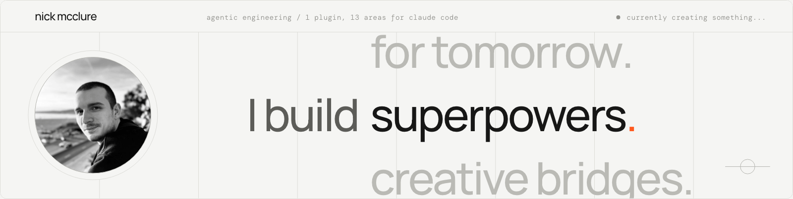
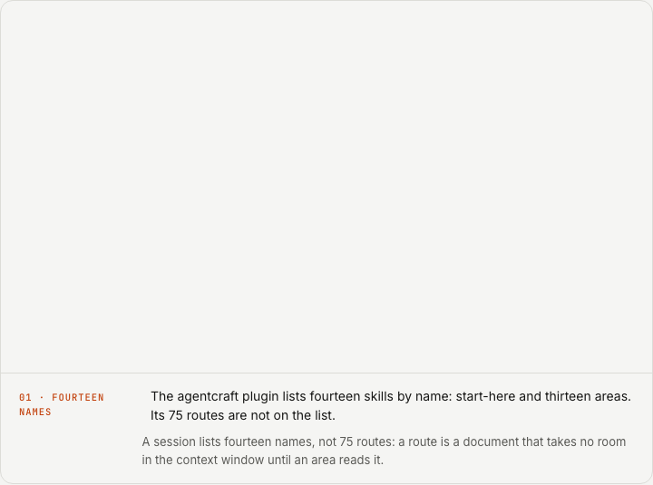
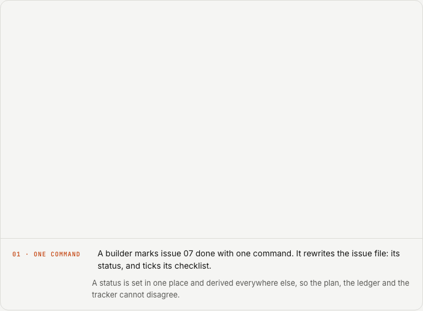
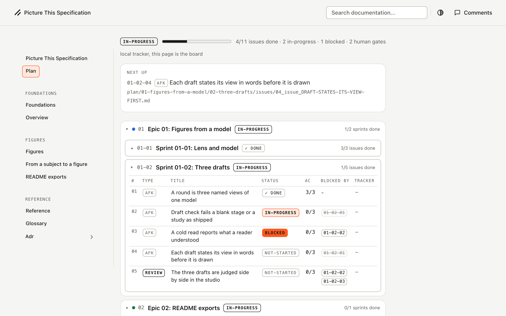
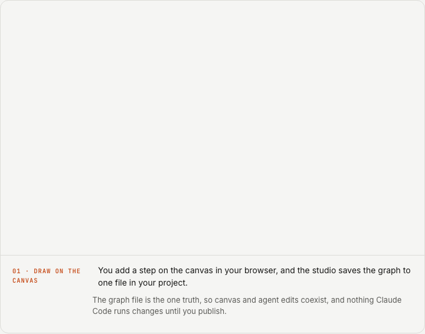
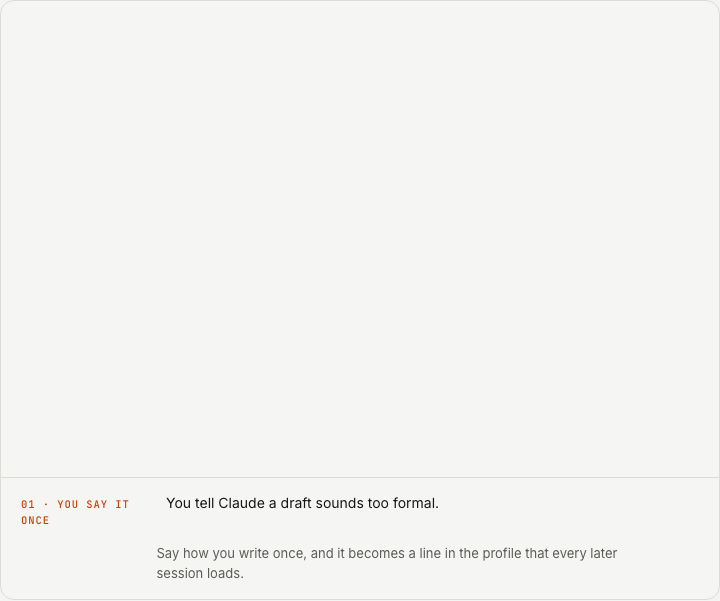
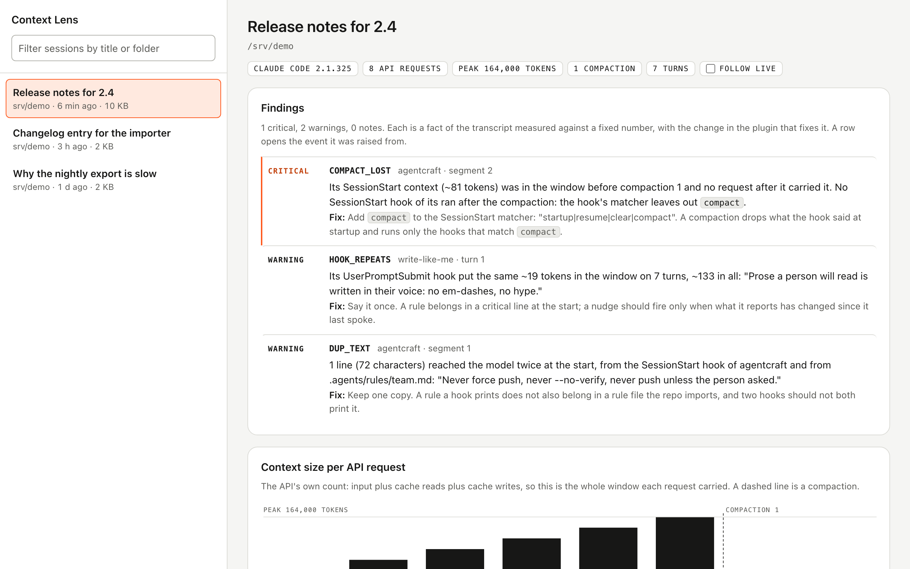
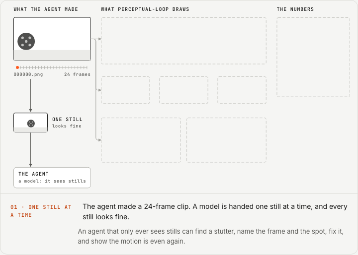
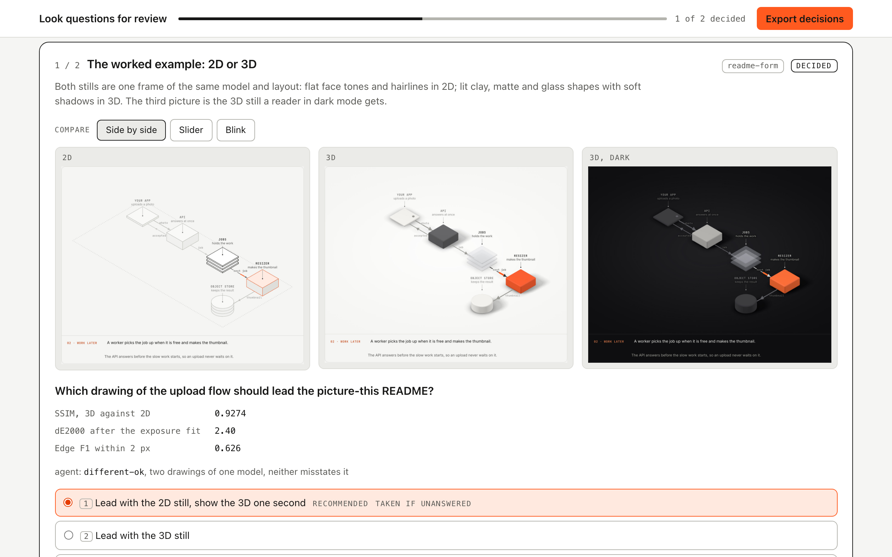
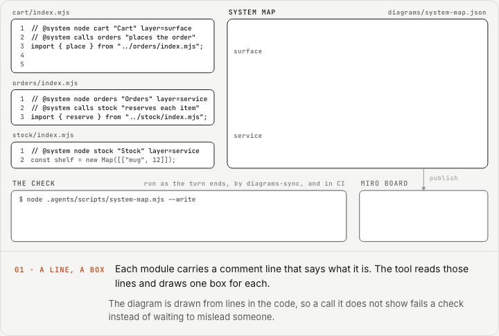

<picture>
  <source media="(prefers-color-scheme: dark)" srcset="docs/assets/banner.dark.gif">
  
</picture>

# Agentic Engineering

Agents can write the code. What they don't do on their own is keep a project
something you can scale, maintain, understand, and hand to a user. `agentic-engineering`
is one Claude Code plugin whose thirteen areas each hold one of those lines, so
what an agent ships is software you would have signed off on.

**It scales.** [agent-works](#agent-works) runs many pieces of work in
parallel without sessions stepping on each other or starving your machine of
the compute a test-heavy build needs.
[delivery](#delivery) holds every contributor's agents to the
same standards, so a team can grow and still move fast in one direction.
[planning](#planning) settles what is being built before
anyone builds it.

**You can still follow it.** People no longer read every line an agent
writes, so the understanding has to live somewhere they will look.
[system-map](#system-map) draws the system from the code itself, which keeps
the people steering a project agreed on what it is.
[docs-parity](#docs-parity) moves the user docs in the same change as the
code: you always know what changed and how it works, and so do the people
using it. [picture-this](#picture-this) turns a mechanism into an animated
figure a stakeholder understands at a glance.

**It is good, not only finished.** A great deal of what makes software usable
is judged by eye or ear: an interface, a render, an animation, a sound.
[perceptual-loop](#perceptual-loop) gives an agent a way to iterate on
exactly that. [code](#code) keeps the code small and its structure sound as
it grows.

**It sounds like you, and it compounds.**
[writing](#writing) runs through all of it: docs, specs, figures
and copy come out in one voice, yours. [harness](#harness)
turns something you worked out with an agent into a plugin held to a standard,
so the next project starts ahead, shows why a session went wrong, and lets you
build the workflow that runs it right.

No single area is the point. Each closes one way a project built with agents
goes wrong, and the sum is a project that reaches the goal you set for it.

> The premise: agents didn't make the fundamentals optional.
> They made them necessary.

## Install

```text
/plugin marketplace add NCMcClure/agentic-engineering
/plugin install agentic-engineering@agentic-engineering
```

Then type `/agentic-engineering:start-here`, or just ask for the work in words.

Coming from the separate plugins? The catalog no longer lists them, so they
do not update into this one. Install `agentic-engineering` by name, then remove each
old one with `/plugin uninstall <old-name>@agentic-engineering`.

Coming from 1.x, when the plugin was named `agentcraft`? Install this one and
open a session before you run `/plugin uninstall agentcraft@agentic-engineering`:
the uninstall deletes that plugin's data directory, and each area copies what it
kept there the first time it runs. Your `userConfig` values do not carry over.

## How the areas work together

The areas are not a pile of tools. A goal too big for one change gets
questioned into a spec and a plan, each issue runs as a card in a session of
its own, and the change that comes out is tested first, judged by eye where
that matters, documented in the same change, written in your voice, reviewed,
and landed. Each area names the next one, so nobody has to remember the step.

<picture>
  <source media="(prefers-color-scheme: dark)" srcset="docs/assets/goal-to-main.dark.gif">
  
</picture>

<sub>One goal, three issues, three sessions. Every hand-off drawn here is a line in one area that names another.</sub>

## The areas

There used to be twelve plugins here, listing about eighty skills between
them, and a job does not say which one it needs. Now there is one thing to
remember. `/agentic-engineering:start-here` asks what you want to do, explains the
area that does it, and hands off to the route that does the work. Given a
task, or run where nobody can answer, it asks nothing and names the route
that fits.

It is the only entry in the slash menu. An area is something an agent calls,
with a route as the first word of its arguments, and a route is a document
the area reads, so it costs the skill listing nothing until it is taken. You
ask for the work in words and the agent picks the area.

<picture>
  <source media="(prefers-color-scheme: dark)" srcset="docs/assets/routes-behind-names.dark.gif">
  
</picture>

<sub>Nine names are listed. The 75 routes behind them stay on disk until an area reads one.</sub>

### agent-works

Agent workflows rot the same way in every repo: `AGENTS.md` bloats, one rule
gets stated four times, task status lives in six places, and two sessions on
one machine never learn the other exists. agent-works gives every kind of fact
one home under `.agents/` with a size budget and checks them all with
`aw doctor`. Tasks and owed gates live on a kanban board every worktree
shares; its `orchestrate` route runs a large goal from it in parallel, each
card in its own worktree, approved by you, reviewed, and landed on green. A
subagent builds each card unless you ask for sessions. A
guard stops the mistakes agents repeat, and locks, leases, notes and learnings
let sessions across projects share one machine. Node 22, nothing else. It is
the foundation the areas below lean on.
[Read more →](plugins/agentic-engineering/skills/agents/README.md)

<picture>
  <source media="(prefers-color-scheme: dark)" srcset="plugins/agentic-engineering/skills/agents/assets/figures/one-window.dark.gif">
  
</picture>

<sub>One orchestrator window carries a whole round: it holds hand-offs and one-line reports, not the work.</sub>

<picture>
  <source media="(prefers-color-scheme: dark)" srcset="plugins/agentic-engineering/skills/agents/assets/screens/doctor.dark.png">
  
</picture>

<sub><code>aw doctor</code>, run on this repo.</sub>

### planning

Code written before the spec is settled is a loan against your future self.
A planning pipeline (spec → grill → architect → plan → publish) plus a build
loop of coordinated TDD agents, all landing in a workspace: `.agents/plan/` for
the project, `.agents/plans/<name>/` for one feature or long task. An autopilot
runs the whole graph hands-off. The backlog publishes
to GitHub or GitLab, and one script owns every status change so the plan and
the tracker cannot disagree quietly.
[Read more →](plugins/agentic-engineering/skills/planning/README.md)

<picture>
  <source media="(prefers-color-scheme: dark)" srcset="plugins/agentic-engineering/skills/planning/assets/figures/folders-climb.dark.gif">
  
</picture>

<sub>A status is set in one place and derived everywhere else.</sub>

<picture>
  <source media="(prefers-color-scheme: dark)" srcset="plugins/agentic-engineering/skills/planning/assets/screens/spec-site.dark.png">
  
</picture>

<picture>
  <source media="(prefers-color-scheme: dark)" srcset="plugins/agentic-engineering/skills/planning/assets/screens/plan-view.dark.png">
  
</picture>

<sub>The spec site and its plan view.</sub>

### delivery

Mixed-skill teams shouldn't rely on discipline to keep prototypes off main.
A repo opts in with one committed file, and from then on session hooks judge
every commit and push the way a shell would read it: protected branches, force
pushes, `--no-verify`, credentials and junk are refused, and a push asks first.
A pre-commit hook covers the terminal and a CI gate backs both. Skills scaffold
a repo, ship and land a change on GitHub or GitLab, and keep tests honest; a
hard test gate is one opt-in away. Owns team version-control conventions; how
agents share a codebase is agent-works' job. The two are meant to run together.
[Read more →](plugins/agentic-engineering/skills/delivery/README.md)

<picture>
  <source media="(prefers-color-scheme: dark)" srcset="plugins/agentic-engineering/skills/delivery/assets/figures/four-commands-one-answer.dark.gif">
  
</picture>

<sub>Each git call in a shell line is judged where it really runs, and one deny stops the line.</sub>

### code

A staged, autonomous optimizer for whatever language your repo speaks
(Python, JS/TS, Go, and Rust are detected out of the box). It organizes the
file tree into an AGENTS.md-hubbed progressive-disclosure layout (orientation
hubs an agent reads before descending), decomposes god-files, and deepens
shallow architecture. Nothing moves until you have seen the plan, every
change sits behind CI-faithful validation with revert-on-red, and nothing is
ever pushed. It writes the hubs and checks that each one names its children.
[Read more →](plugins/agentic-engineering/skills/code/README.md)

<picture>
  <source media="(prefers-color-scheme: dark)" srcset="plugins/agentic-engineering/skills/code/assets/figures/drifted-to-organized.dark.gif">
  
</picture>

<sub>One small repo, stage by stage: the plan first, the tree tidied, a red change put back, the long file split.</sub>

<picture>
  <source media="(prefers-color-scheme: dark)" srcset="plugins/agentic-engineering/skills/code/assets/screens/report.dark.png">
  
</picture>

<sub>The architecture report, written about this repo's own tooling.</sub>

### harness

Claude Code dynamic workflows are programs; you should be able to see them.
An Unreal-Blueprint-style node canvas that compiles graphs to runnable
`.claude/workflows/*.js` and round-trips them back, plus a route for
hand-authoring without the GUI. [Read more →](plugins/agentic-engineering/skills/harness/README.md)

<picture>
  <source media="(prefers-color-scheme: dark)" srcset="plugins/agentic-engineering/skills/harness/assets/figures/two-folders.dark.gif">
  
</picture>

<sub>The graph file is the one truth, and nothing Claude Code runs changes until you publish.</sub>

<picture>
  <source media="(prefers-color-scheme: dark)" srcset="plugins/agentic-engineering/skills/harness/assets/screens/canvas.dark.png">
  
</picture>

<sub>The canvas.</sub>

### picture-this

A system that takes three paragraphs to explain usually takes one good
picture. Describe how something works, or point at a feature in your
codebase, and get three rough animated drafts to choose from, each a
different picture designed from that subject and not from a template. The one you pick becomes a React component that embeds in MDX,
with light and dark stills for a plain README. It replaces
`animated-storytelling`.
[Read more →](plugins/agentic-engineering/skills/docs/README.md)

<picture>
  <source media="(prefers-color-scheme: dark)" srcset="docs/assets/iso-flow.dark.gif">
  
</picture>

<sub>The area's worked example, filmed by the area. Every other figure on this page was drawn with it, and so was the banner.</sub>

### writing

Everything an agent drafts for you ships in someone else's voice. A
calibrated, tightly line-budgeted profile of how *you* write auto-loads into
every session, skills audit text for AI tells by hunting clusters of
co-occurring patterns rather than lone buzzwords, and reflective hooks fold
your style feedback back into the profile.
Prose only: code and commit messages stay out of scope.
[Read more →](plugins/agentic-engineering/skills/writing/README.md)

<picture>
  <source media="(prefers-color-scheme: dark)" srcset="plugins/agentic-engineering/skills/writing/assets/figures/profile-page-revised.dark.gif">
  
</picture>

<sub>One remark about your style becomes a line in the profile every later session loads.</sub>

### code

Every line an agent writes gets paid for more than once: at generation, at
review, and in every future session that loads it as context. code makes
the agent build at the lowest rung that works (a 7-rung ladder with hard
safety carve-outs, kept in context as one line where the repo has opted in),
checks what already exists before building, reviews diffs with script-located
candidates and cuts applied behind validate-or-revert, and tracks every
deliberate shortcut as a `debt:` marker with an expiry trigger. Evolved from
the MIT-licensed ponytail plugin; borrowed stays labeled as borrowed.
[Read more →](plugins/agentic-engineering/skills/code/README.md)

<picture>
  <source media="(prefers-color-scheme: dark)" srcset="plugins/agentic-engineering/skills/code/assets/figures/cut-by-cut.dark.gif">
  
</picture>

<sub>A cut that turns a check red costs only itself, and the report counts the lines that landed.</sub>

### harness

A plugin's true cost is invisible until it's installed, and authoring a good
one means guessing at standards nobody wrote down. This is both halves of
that problem on one rubric: plugin-create interviews you, scaffolds the
layout (a skill per job, or areas with routes and one skill to type), and
authors against the six evaluation dimensions; plugin-evaluate
scores any path or git URL into an HTML scorecard with an adopt/rework
verdict; plugin-improve applies the fixes ranked by how many points each one
buys back; marketplace-refresh reinstalls a checkout's plugins so you can try
them.
[Read more →](plugins/agentic-engineering/skills/harness/README.md)

<picture>
  <source media="(prefers-color-scheme: dark)" srcset="plugins/agentic-engineering/skills/harness/assets/figures/ledger-to-verdict.dark.gif">
  
</picture>

<sub>Every number on the scorecard is the script's.</sub>

<picture>
  <source media="(prefers-color-scheme: dark)" srcset="plugins/agentic-engineering/skills/harness/assets/screens/scorecard.dark.png">
  
</picture>

<sub>A scorecard for picture-this.</sub>

### harness

A score says what a plugin should cost. This says what it did. Hooks are
invisible from both ends: you never see a session-start briefing, and the
agent cannot tell which of its context came from where, or what came back
after a compaction. Claude Code records all of it in the session transcript,
and the lens reads it back: each hook's output and who saw it, which skills
kept their description in the listing, the size of every request, and what a
compaction threw away. Then it names what went wrong, each finding with the
fix: a hook over the host's cap, context a compaction did not bring back, a
skill call the host refused. It used to be an area of its own, context-doctor.
[Read more →](plugins/agentic-engineering/skills/harness/README.md)

<picture>
  <source media="(prefers-color-scheme: dark)" srcset="plugins/agentic-engineering/skills/harness/assets/figures/lost-at-compaction.dark.gif">
  
</picture>

<sub>Nothing fails when a rule is lost at a compaction. The transcript is where it shows.</sub>

<picture>
  <source media="(prefers-color-scheme: dark)" srcset="plugins/agentic-engineering/skills/harness/assets/screens/context-lens.dark.png">
  
</picture>

<sub>The lens reading a synthetic session.</sub>

### perceptual-loop

An agent can't iterate on what it can't measure. For work judged by eye or ear
(a render, a UI, a clip, a sound) it supplies the loop code already has:
reproducible shots, numbers that gate regressions against measured noise,
sheets the agent opens with its own vision, and one review page that batches
the taste questions for you. One Node CLI does the measuring, a hook keeps
runs small, and a blind critic judges a picture without being told what it was
meant to be. It measures looks and does not coordinate agents: locks, leases
and machine load are agent-works' job. [Read more →](plugins/agentic-engineering/skills/design/README.md)

<picture>
  <source media="(prefers-color-scheme: dark)" srcset="plugins/agentic-engineering/skills/design/assets/figures/toward-a-reference.dark.gif">
  
</picture>

<sub>A still against its reference: where they differ, drawn as a map, and the marked place enlarged and scored by itself.</sub>

<picture>
  <source media="(prefers-color-scheme: dark)" srcset="plugins/agentic-engineering/skills/design/assets/figures/motion-between-frames.dark.gif">
  
</picture>

<sub>Motion: the frame whose step stands out, the frames round it, and which way things moved between them.</sub>

<picture>
  <source media="(prefers-color-scheme: dark)" srcset="plugins/agentic-engineering/skills/design/assets/figures/sound-you-can-see.dark.gif">
  
</picture>

<sub>Sound: a click the agent cannot hear, standing as a tall line in the picture and named by its time.</sub>

<picture>
  <source media="(prefers-color-scheme: dark)" srcset="plugins/agentic-engineering/skills/design/assets/screens/review.dark.png">
  
</picture>

<sub>The review page.</sub>

### docs-parity

User docs drift because they ship after the code. docs-parity makes them part
of the change: the commit that moves a button rewrites the page and retakes
the screenshot, through a writer contract (audiences, a page shape, grounded
claims) and a capture harness that makes every picture from the built product
deterministically, for web, desktop, CLI, Unreal, Qt or mobile. One checker
maps code to pages and finds missing, stale and broken docs, telling the
agent in session and failing in CI, for a site, a `docs/` folder, a wiki or a
README. A README check keeps the front page written for people.
[Read more →](plugins/agentic-engineering/skills/docs/README.md)

<picture>
  <source media="(prefers-color-scheme: dark)" srcset="plugins/agentic-engineering/skills/docs/assets/figures/docs-move-with-code.dark.gif">
  
</picture>

<sub>The code changes, so the page is rewritten and the screenshot retaken, in the same change.</sub>

### system-map

An architecture diagram is true on the day it is drawn. system-map moves it
into the code: each module declares what it is and whom it calls in `@system`
comment lines, the map is extracted from them into a diffable file committed
beside the code, and a checker holds it to the real import graph, so a module
or a call nobody declared fails the check instead of quietly dating the
picture. A Stop hook runs that check on what a turn changed and tells the
agent before the turn ends; the same script in CI fails the pull request. A whole-repo sweep reads every module's lines against its code for
what a checker cannot judge. Miro is where the map is drawn: generators put
it, or any other frame, on a board through a lint that refuses overlaps and
crossed connectors, a live check of what Miro actually drew, and a pull that
keeps layout changes made on the board. It holds no credentials: publishing
goes through the Miro MCP you connect.
[Read more →](plugins/agentic-engineering/skills/docs/README.md)

<picture>
  <source media="(prefers-color-scheme: dark)" srcset="plugins/agentic-engineering/skills/docs/assets/figures/map-true-to-code.dark.gif">
  
</picture>

<sub>A comment line draws a box or an arrow. An import nobody declared fails the check until the map is brought level.</sub>

Every area and route on one page: [docs/plugins.md](docs/plugins.md).

## Working in this repo

The contribution contract (layout invariants, the versioning rule, how to
add or change an area or a route) lives in [.agents/rules/dev-rules.md](.agents/rules/dev-rules.md).
`npm run validate` checks the enforceable parts and `npm test` runs every hook;
CI runs both on every push. Agents maintaining this repo read the same rules
you do, and [CONTRIBUTING.md](CONTRIBUTING.md) has the dev loop.

## License

MIT; see [LICENSE](LICENSE).
