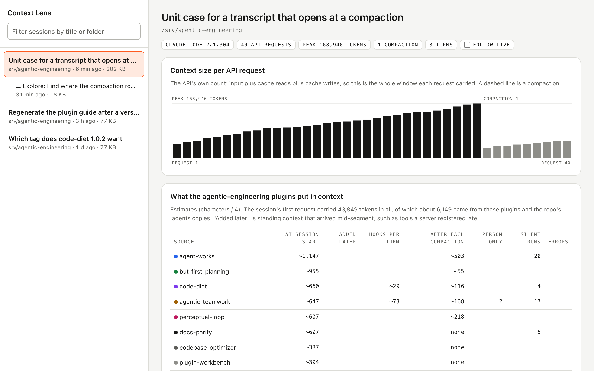

# context-doctor

A plugin's hooks are invisible from both ends. The person never sees a
SessionStart briefing, and the agent cannot tell which of its context came
from which area, which of it reached the person instead, or what came back
after a compaction. Claude Code records all of it in the session transcript,
and this area reads it back.

It is the measured half of a plugin's cost. The `plugin-workbench` area
scores what a plugin should cost from its files; this says what it did cost
in a session.

## How it works

The `diagnose` route reads a session transcript for the faults that have a
known cause, and names each with where it happened and the change in the
plugin that fixes it:

| Level | It finds |
|---|---|
| critical | a hook over the host's 10,000 characters, start context a compaction did not bring back, a skill call the host refused |
| warning | a hook near the cap or failing, output that reached only the person, the same text on every turn or said twice, critical lines over their total, context that came back only on a resume, a route not read again after a compaction, skills listed by name only, a skill called twice, a searcher subagent given the build rules |
| info | what limits the reading: a resume that repeated the start, hooks no plugin claimed, a partial transcript |

A script raises the findings, each a fact of the transcript measured against
a number in `scripts/thresholds.mjs`; the agent explains them and fixes one
only when asked.

The `lens` route reads a session transcript
(`~/.claude/projects/<slug>/<id>.jsonl`) and reports, by area and by hook:
each hook's output and who saw it (the model, the person, or nobody), the
skill listing and which entries kept a description, the API's own token count
for each request, every call on the Skill tool and whether the host refused
it, and what each compaction kept or lost. `report` prints to the terminal;
`serve` opens a page on 127.0.0.1, with the findings as its first card.

<picture>
  <source media="(prefers-color-scheme: dark)" srcset="assets/screens/context-lens.dark.png">
  
</picture>

The page `serve` opens, here on a sample session in this repo: the size of
every request with the compaction marked, then what was put in at the start
and what came back after the compaction. The picture is from before the
findings card, which now sits above the chart.

The text is the transcript's own, and a request's size is the API's own
count. A per-item token figure is an estimate, characters over four, and is
said to be one. Reading changes nothing: no script here edits a plugin, a
hook, or a transcript.

## Install

```text
/plugin marketplace add NCMcClure/agentic-engineering
/plugin install agentcraft@agentic-engineering
```

Node 22, no dependencies.

## Routes

Ask for one in words ("why did my last session forget the rules after it compacted?"),
or type `/agentcraft:start-here` and say what you want: an area cannot be
typed. An agent reaches a route as `/agentcraft:context-doctor <route>`.

| Route | Started by | Does |
|---|---|---|
| `diagnose` | the agent, or you by asking (`[session id or transcript path] [--json]`) | Finds what went wrong with a session's context: each finding with its level, whose it is, where, and the fix. |
| `lens` | the agent, or you by asking (`[report\|serve] [session id or transcript path]`) | Reads a session transcript back: what entered the context, when, from which area and hook, and what survived a compaction. |

## Running the script yourself

```bash
node scripts/context-lens.mjs diagnose               # the findings for the newest session in this directory
node scripts/context-lens.mjs report                 # the newest session in this directory
node scripts/context-lens.mjs report <session-id>     # or a transcript path
node scripts/context-lens.mjs serve                   # the page, on 127.0.0.1
node scripts/context-lens.mjs list                    # recent sessions on this machine
```

Paths are relative to this area's directory.
