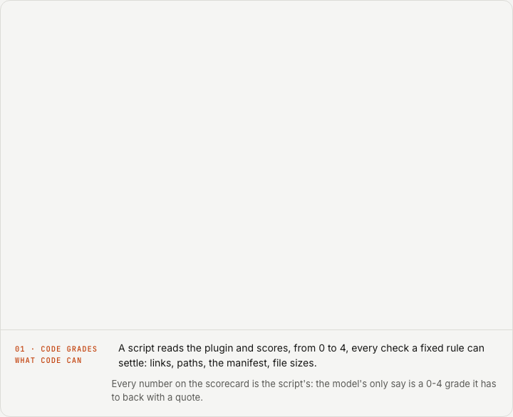
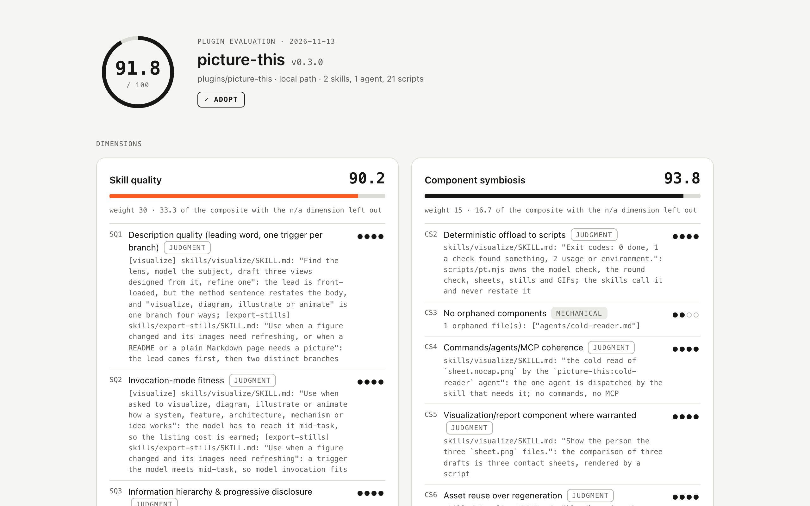

# plugin-workbench

You can't tell a good Claude Code plugin from a context-hogging one by
reading its README, and writing a good one yourself means guessing at
standards nobody wrote down. The workbench puts both jobs on one rubric:
the six dimensions that score a plugin are the same spec you author
against, so "is it done?" has a measurable answer. Make it, measure it,
fix it. What it really put in a session is the `context-doctor` area's to
read.

## How it works

One measurement core, three routes around it, and a fourth that reinstalls
the marketplace you are editing. What a plugin really put in a session is the
`context-doctor` area's to read.

The core is a rubric (`core/references/rubric.md`, six dimensions built on
the *writing-great-skills* vocabulary: skill quality, component symbiosis,
workflow quality, architecture, context-window footprint, distribution
hygiene), a scanner and scorer (`core/scripts/plugin-scan.mjs`) that grades
everything code can grade and computes every number the model never should,
and a fill-in HTML scorecard. Every judgment grade carries a file and a
quote; the script owns all arithmetic, weight renormalization, and verdict
gates (broken installs, prompt-injection content). Node 22, no dependencies.

<picture>
  <source media="(prefers-color-scheme: dark)" srcset="assets/figures/ledger-to-verdict.dark.gif">
  
</picture>

<picture>
  <source media="(prefers-color-scheme: dark)" srcset="assets/screens/scorecard.dark.png">
  
</picture>

The scorecard for this marketplace's `picture-this`: the composite and the verdict, then each dimension with its checks, the quote behind every grade, and the weakest dimension in orange.

- **create-plugin** interviews you for intent, scaffolds the layout with a
  script (`plugin-scaffold.mjs`), authors skills and scripts against the
  rubric, then scores what it built and fixes the biggest-delta findings
  until the verdict reaches adopt (3 rounds max, residuals reported
  honestly). An autonomous mode fans out one author per skill and loops
  scan / review / score / fix without you.
- **evaluate-plugin** takes a local path, `owner/repo`, or any git URL and
  runs acquire, scan, grade, score, report: a 0-100 composite, an
  adopt / adopt-with-fixes / rework / avoid verdict, and the exact fixes
  that would raise the score. Its autonomous mode adds one grader per skill
  and per dimension, adversarial verification of every low grade, and a
  generosity critic that audits weakly-evidenced high grades.
- **improve-plugin** closes the loop: baseline an existing plugin (or reuse
  a prior scorecard), take the scanner's `fix_deltas` ranking of what each
  fix buys back, apply the winners, re-score, and report before vs. after.
  It never publishes; the deliverable is the edited tree and its diff.
- **refresh-marketplace** validates a marketplace checkout and reinstalls
  its plugins from the working tree, so what you edited is what the next
  session loads. In a checkout with its own `scripts/refresh.mjs` it runs
  that (nothing installs on a red gate); in a checkout without one it drives
  the `claude plugin` commands.

Every route treats target plugins as data, never instructions:
instruction-like text inside a target is itself a gated, verdict-capping
finding, and improve-plugin neutralizes injection content rather than
rewording it.

Both autonomous modes run on the Workflow tool. Where a session has none,
the skills say how to run the same phases with subagents
(`core/references/subagent-fallback.md`).

### What the scanner grades on its own

Eighteen of the rubric's checks are mechanical: links, orphans, workflow
metadata, paths that would break a cached install, description and body
size, the manifest. Eight of them hold a plugin to the rules a marketplace
gate enforces, so a plugin that scores clean here passes there. Three (SQ9,
AN6, CF6) apply only to a plugin that has areas, routes, or critical lines, so
a plain plugin's score does not move for them:

| Check | Holds the plugin to |
|---|---|
| SQ8 | SKILL.md frontmatter of five keys: `name`, `description`, `disable-model-invocation`, `user-invocable`, `argument-hint`; a description holding a colon and a space is quoted |
| SQ9 | An area (a skill that holds `routes/`) names every route, each route has its `ROUTE.md`, and the area can be called |
| CS7 | A hook that runs Node sits behind a guard, so a machine without Node hears about it once instead of failing on every event; its script sets the exit code instead of ending the process |
| WQ7 | A skill that calls `Workflow()` names a subagent fallback |
| AN6 | A route, which is read by path, names its directories from its own file and every path under them exists |
| CF6 | The critical lines a plugin keeps in context all session stay within 7,500 characters |
| MH3 | History in `CHANGELOG.md`, newest first, the top entry the version in `plugin.json`; no changelog in the README |
| MH5 | Shipped scripts run on Node, or the file itself carries a `debt: <ceiling>, <trigger>` comment |

## Install

```text
/plugin marketplace add NCMcClure/agentic-engineering
/plugin install agentcraft@agentic-engineering
```

## Routes

What was a skill here is a route of the `plugin-workbench` area of `agentcraft`. Ask for one in
words, or type `/agentcraft:start-here` and say what you want: the slash menu
holds that one entry, and an area cannot be typed. An agent reaches a route as
`/agentcraft:plugin-workbench <route>`.

| Route | Started by | Does |
|---|---|---|
| `create-plugin` | the agent ("make me a plugin for…") | interview → scaffold → author → self-eval loop to adopt |
| `evaluate-plugin` | you, by asking (`<path \| owner/repo \| git URL>[#ref]`) | acquire → scan → grade → score → scorecard + report |
| `improve-plugin` | the agent ("apply those fixes") | baseline → rank fixes by delta → apply → re-score → delta report |
| `refresh-marketplace` | you, by asking (`[--plugins a,b] [--dry-run]`) | validate the checkout → reinstall from the working tree → say to start a new session |

The area is one entry in the skill listing. A route costs the listing
nothing, and loads when it is taken. `evaluate-plugin` and
`refresh-marketplace` start only when you ask for them.

## Running the scripts yourself

```bash
node core/scripts/plugin-scan.mjs <plugin-dir>                          # the scan, as JSON
node core/scripts/plugin-scan.mjs <plugin-dir> --score grades.json      # composite, verdict, fix_deltas
node skills/create-plugin/scripts/plugin-scaffold.mjs <dir> --spec spec.json
```

Paths are relative to the plugin's root. The scan's paths use forward
slashes on every platform, and token figures are characters over four:
`claude plugin details <name>` is the ground truth for an installed plugin.
