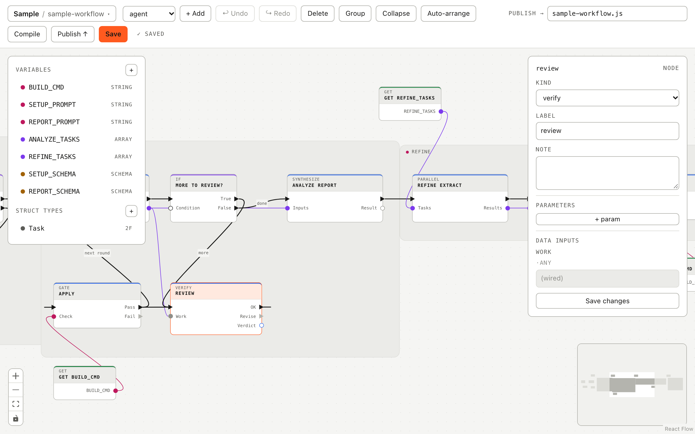
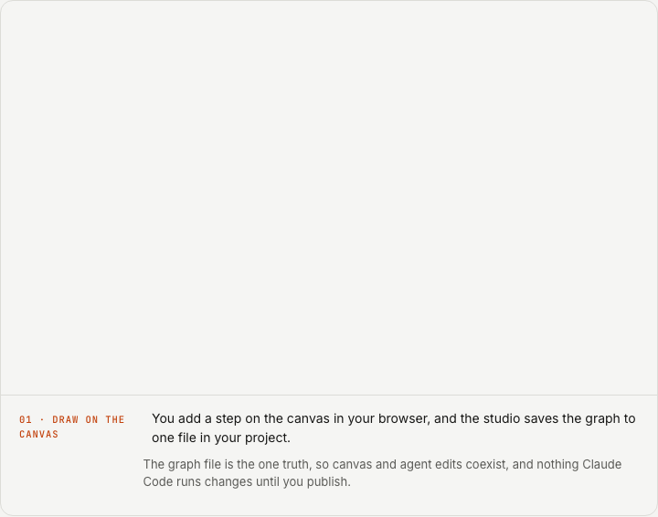

# Workflow Studio

An Unreal-Blueprint-style visual editor for Claude Code dynamic workflows:
drag nodes, wire pins, and compile the graph losslessly to
`.claude/workflows/*.js`. No blueprint compiler errors, though. Mostly.

<picture>
  <source media="(prefers-color-scheme: dark)" srcset="assets/screens/canvas.dark.png">
  
</picture>

The sample workflow's review loop: declared variables on the left, the selected
node's fields on the right, and a hue on each node and wire that says what kind
it is.

## How it works

The area bundles the studio, a Vite app, under `app/`. Asking to open the
studio runs `scripts/launch-studio.mjs`, which copies the app into a persistent
install home (`workflow-studio/app` in the `agentcraft` plugin's data directory), runs `npm ci`
there when the lockfile has changed since the last install, and starts the dev
server with the studio root pointed at your project. Your graphs live in the
project, never in the install home, so they survive restarts and plugin
updates. The launcher is plain Node with no dependencies; the app's own
dependencies come from npm on first launch.

## Install

```text
/plugin marketplace add NCMcClure/agentic-engineering
/plugin install agentcraft@agentic-engineering
```

Then:

1. Ask to open the workflow studio.
2. Open the printed `Local:` URL in your browser (Vite picks the port; trust
   the printout, not 5173).

The first launch installs the app: expect 30–60 seconds, Node 20+, and network
access, once. After that, launches are near-instant and offline-friendly.

## Routes

What was a skill here is a route of the `workflow-studio` area of `agentcraft`. Ask for one in
words, or type `/agentcraft:start-here` and say what you want: the slash menu
holds that one entry, and an area cannot be typed. An agent reaches a route as
`/agentcraft:workflow-studio <route>`.

| Route | What it does |
|---|---|
| the area, with no route | Launches the visual studio (Vite dev server) and hands you the URL. |
| `author-workflow` | Hand-author or edit workflows and `diagram.json` graphs: no GUI, just the protocol docs. |

## Storage layout

Workflow projects persist under the current project's
`.claude/workflow-studio/` directory (falling back to
`~/.claude/workflow-studio/` outside a project):

```
<studio-root>/
  <project-id>/
    project.json                          # studio project metadata
    workflows/
      <workflow-id>/
        diagram.json                      # the graph (hot-synced into the open canvas)
        compiled.js                       # compiled output
```

**Compile** writes only the studio-internal `compiled.js`; **Publish** promotes
it to the workflow's publish path (default `.claude/workflows/<workflow>.js`,
where Claude Code runs it), confirmed first and confined to the project
directory — the server rejects any target outside it. A live file-watcher syncs
on-disk `diagram.json` edits into an open canvas, so hand edits and the GUI
coexist peacefully. A `.studio.lock` under the studio root lets the launcher
detect an already-running instance and hand back its URL instead of starting a
second one.

<picture>
  <source media="(prefers-color-scheme: dark)" srcset="assets/figures/two-folders.dark.gif">
  
</picture>

## Manual fallback

If you'd rather skip the launcher script:

```bash
cd app
npm install
STUDIO_ROOT=/path/to/your/.claude/workflow-studio npm run dev
```

## Provenance

The `app/` directory was vendored from
[github.com/NCMcClure/workflow-editor](https://github.com/NCMcClure/workflow-editor)
@ `studio-overhaul`, commit `8c65333534077e44cced1bc37beb3fc937512195`, and
**has since diverged**: as of 0.2.0 this plugin is the primary home of the app
code (security hardening, Publish flow, launcher lock), and upstream sync is a
manual, by-hand merge in whichever direction is wanted — never a blind re-copy.

(`app/docs/` was already plugin-maintained before the divergence — its
authoring protocol was rewritten for the studio layout in 0.1.1.)
