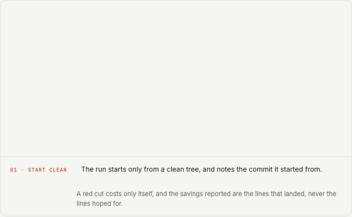
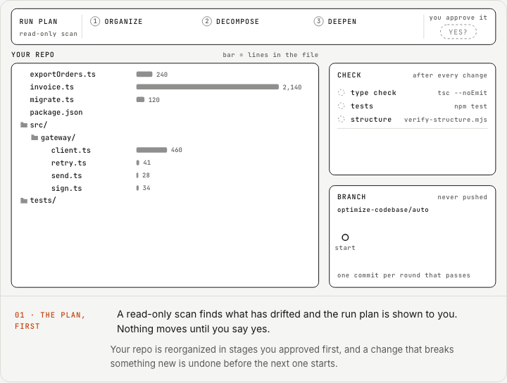
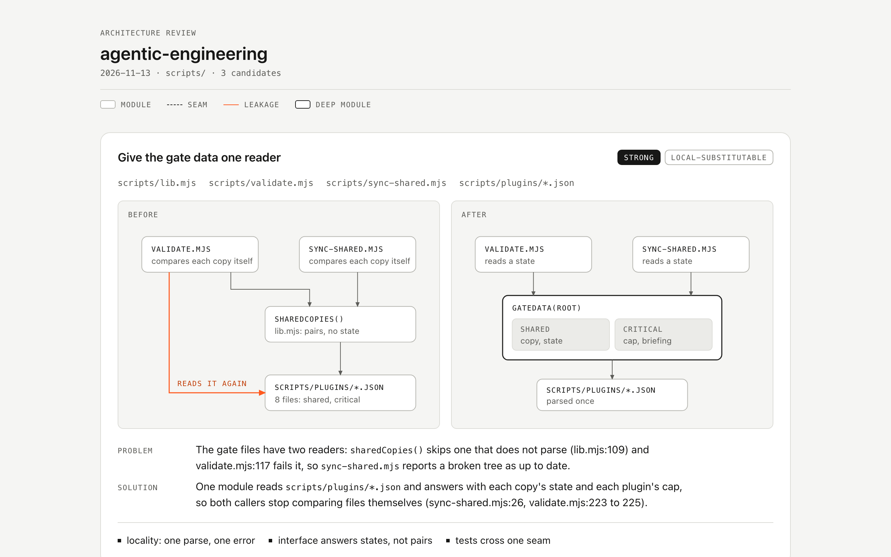

# code

Every line an agent writes gets paid for more than once: at generation, again
at review, and again in every future session that loads it as context. Agents
over-build by default, and the surplus compounds until the repo itself has
accreted: roots full of loose files, god-files, shallow pass-through layers
that neither a newcomer nor an agent can navigate. This area prices the line at
each of those moments, and restructures what piled up anyway, in stages behind
the repo's own tests.

It joins two areas that used to stand apart: code-diet (the diet routes) and
codebase-optimizer (the restructuring routes).

## How it works

### The diet: the change in hand

**Before the code.** One ladder line stays in the agent's context: YAGNI, reuse
what the repo already has, stdlib, the platform, an installed dependency, one
line, then the minimum that works, with four carve-outs that are never climbed
past (trust-boundary validation, data-loss handling, security, accessibility).
The `ladder` route is the full procedure behind that line. `reuse` is rung 2
with a tool: `scripts/reuse-index.mjs` searches this repo, and any other
checkout you list, for a file whose name, opening comment, or definitions
cover the thing about to be built.

**At review.** The `review` route has `scripts/review-scan.mjs` locate cut
candidates deterministically (single-caller wrappers, abstractions with one
implementation, dependencies that duplicate the platform, dead flags, uncalled
symbols). The model judges only the flagged spots and reports one line each:
file:line, the cut, the replacement. With `--apply`, each confirmed cut is
checked while it is the only change in the tree, committed on green, and put
back on red; the report says what was realized, never what was possible.

<picture>
  <source media="(prefers-color-scheme: dark)" srcset="assets/figures/cut-by-cut.dark.gif">
  
</picture>

**In every later session.** A deliberate shortcut carries a comment
`debt: <ceiling>, <trigger>`. The `debt` route inventories the markers and
re-judges each, so a deferral expires on its trigger instead of rotting. A
hook after each edit nudges the agent, and never blocks it, when a marker it
just wrote names a ceiling and no trigger. The grammar lives in one file,
`scripts/debt.mjs`, which the hook and the route both read.

**On the way out.** `capture` asks the reuse question the other way round:
what did this work build that another project would want? It writes a row per
candidate in `.agents/reuse-opportunities.md`; nothing is filed or moved for
you.

### Restructuring: the repo as it stands

Three stages, one engine, run in order on a dedicated branch:

- **Organize** tidies the file tree with history-preserving `git mv` and
  reference rewriting, then writes an `AGENTS.md` orientation hub in the root
  and every non-leaf code directory: one honest line per child, what it holds
  and when to descend.
- **Decompose** splits god-files into focused modules behind compatibility
  shims (re-export shims, barrel files, same-package splits, per ecosystem).
- **Deepen** reshapes shallow modules and leaky seams, one at a time.

Four things hold for all of them:

1. **Nothing moves until you have seen the plan.** The organizer stops between
   its plan and its apply; the sweep shows its run plan and waits. The
   workflows refuse to start without that yes.
2. **Every change is validated and reverted on red.** Smoke or compile check,
   targeted tests and lint run against a baseline of failures already present;
   anything newly red is put back. Nothing is ever pushed, `git clean` is
   banned, and cruft is quarantined to `archive/`, never deleted.
3. **Scripts supply the facts.** `repo-scan.mjs` profiles the tree,
   `verify-hubs.mjs` checks the hubs against it, and `verify-structure.mjs`
   grades both: a critical finding fails a stage, a warning is reported.
4. **Decisions are written down.** An architecture review reads the glossary
   at `.agents/CONTEXT.md` and the decision records under `.agents/decisions/`,
   and offers a new record when a choice would otherwise be re-argued.

<picture>
  <source media="(prefers-color-scheme: dark)" srcset="assets/figures/drifted-to-organized.dark.gif">
  
</picture>

It detects Python, JS/TS, Go, and Rust from the manifests and runs a generic
mode on anything else. The detail (ecosystem profiles, the hubs, the severity
ladder, the safety model, reviewing results, limitations) is in
[docs/how-it-works.md](docs/how-it-works.md).

The `deepen` route's report is one HTML page, written to the temp directory and
opened for you. Each candidate is a card: the files, a before and after
diagram, the problem and the fix in a sentence each.

<picture>
  <source media="(prefers-color-scheme: dark)" srcset="assets/screens/report.dark.png">
  
</picture>

This one reviews the marketplace's own `scripts/` folder; the orange wire is
the leak the first candidate removes. The result of a sweep is per-round
commits on a branch and a rollup to review before you run the tests and merge.
Re-running is safe: finished work is skipped.

## Where it speaks

The ladder line and the edit nudge reach the agent only where the repo has
opted in to the agentic-engineering plugin: it carries `.agents/manifest.json`
or one of the plugin's own markers, or you answered the one-time question a
session asks in a repo it has not seen. Answer `off` and the area says nothing
there. Where it does speak, the ladder comes back after a compaction or a
`/clear`, and it reaches subagents that write code but not the read-only agent
types (search, planning, and the host's own helpers), which have no use for
build rules. The routes work in any repo, opted in or not.

## Install

```text
/plugin marketplace add NCMcClure/agentic-engineering
/plugin install agentic-engineering@agentic-engineering
```

Requirements: Node 22 for the bundled scripts, which run on a repo of any
language. A restructure also needs a **git** repository and the repo's **own
toolchain** on PATH (`uv` and `pytest`, `npm` and `tsc`, `go`, `cargo`); the
engine detects it and never installs anything. Without Node the organize stage
and the structure checks are skipped with a note; decompose and deepen still
run.

## Routes

Ask for one in words ("cut the bloat from this diff", "tidy the file tree"), or
type `/agentic-engineering:start-here` and say what you want: the slash menu
holds that one entry, and an area cannot be typed. An agent reaches a route as
`/agentic-engineering:code <route>`.

| Route | Started by | Does |
|---|---|---|
| `ladder` | the agent | The build discipline: understand the flow, climb the seven rungs, mark debt, leave one runnable check, output code first. |
| `reuse` | the agent, or you by asking (`<thing>`) | Searches this repo and your listed checkouts for something that already covers the thing; verdict adopt, adapt, or build. |
| `review` | the agent, or you by asking (`[repo] [--base <ref>] [--apply]`) | Over-engineering review: the script locates, the model judges, one line per finding; `--apply` lands each cut as its own commit behind validate-or-revert. |
| `debt` | the agent, or you by asking (`[--write <file>]`) | The debt-marker ledger: which deferrals still hold, which triggers have tripped, which markers have none. |
| `capture` | the agent at wrap-up | Finds what this work built that another project would want and records it in `.agents/reuse-opportunities.md`. |
| `restructure` | the agent, after your yes | The whole sweep: organize, decompose, deepen, in that order, on one branch (default `optimize-codebase/auto`). |
| `organize` | the agent, after your yes | The file tree alone: plan, your approval, moves and reference rewrites, hubs, verification. Also "just add hubs to my repo". |
| `deepen` | the agent | The seams alone: a visual report of deepening candidates, then a design conversation about the one you pick. |

## Pointing it at your other code

`reuse` searches the repo you are in. To have it search other checkouts too (a
shared component library, a sibling service), list them once in git config;
the key takes as many paths as you add:

```bash
git config --global --add code-diet.reuse ~/src/shared-ui
```

Use `--local` to keep a path to one clone. A listed directory that is not on
this machine is reported as not searched, never silently skipped. Nothing
leaves the machine: the index reads files and git config.

## `--apply`, exactly

`review --apply` starts from a clean tree: `review-scan.mjs --apply begin`
refuses while tracked files carry uncommitted changes, because a cut landed
over them would carry them into its commit. Commit or stash first; the
findings stand. Then, per cut: the edit, `--apply check` with the repo's own
checks (only the ones that were green before any cut), one commit on green,
one repair attempt and `--apply revert` on red. The script never resets,
cleans, stashes, commits, or pushes, and it refuses to touch a file that is
not in HEAD, so your untracked files are safe by construction. A cut that
landed with no check to run is reported as `applied, not validated`, not as
green.

## The scripts, by hand

They are ordinary commands, useful outside the routes. From this area's
directory:

```bash
node routes/organize/scripts/repo-scan.mjs <repo>                      # the tree's profile, as JSON
node routes/organize/scripts/verify-hubs.mjs <repo>                    # hubs against the tree; exit 1 on a finding
node routes/organize/scripts/verify-structure.mjs <repo> --subtree ""  # everything, graded; exit 2 on a critical finding
node scripts/reuse-index.mjs "<thing>"                                 # what already covers the thing
node scripts/debt.mjs                                                  # the debt markers in this repo
```

## Provenance

The discipline is evolved from the MIT-licensed
[ponytail plugin](https://github.com/DietrichGebert/ponytail). What was
inherited and what changed is recorded in
`routes/ladder/references/provenance.md`. Borrowed stays labeled as borrowed.

## History

This area joins two plugins that once stood alone. Their changelogs are kept as they were: [code-diet](history/code-diet.md) and [codebase-optimizer](history/codebase-optimizer.md).
