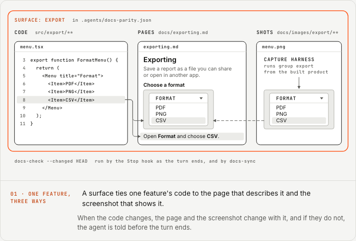
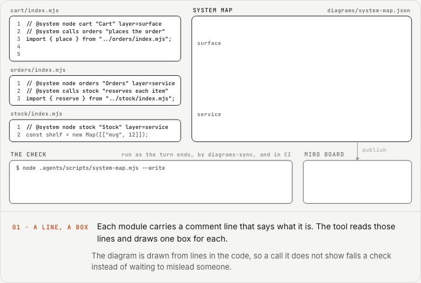
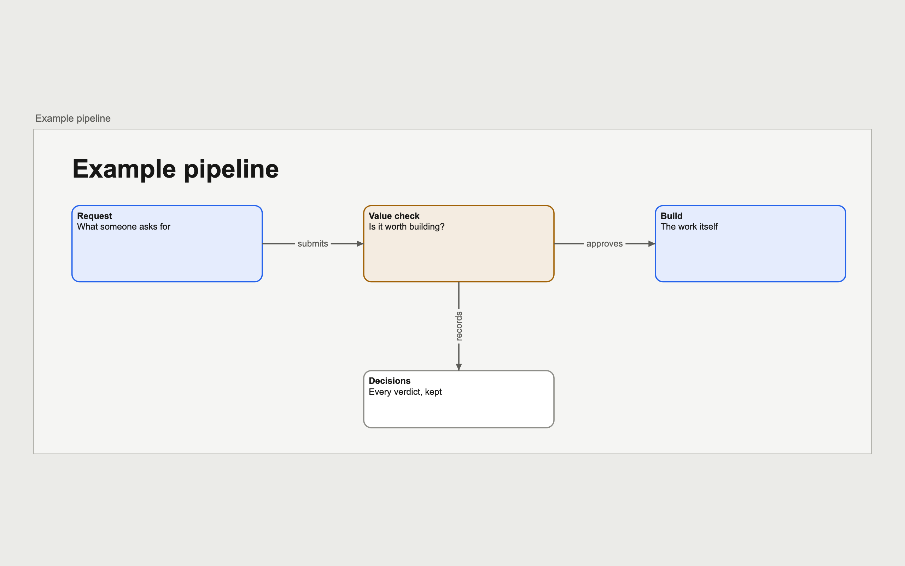
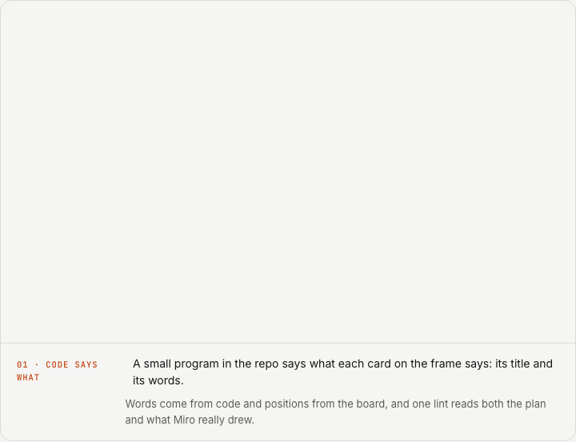
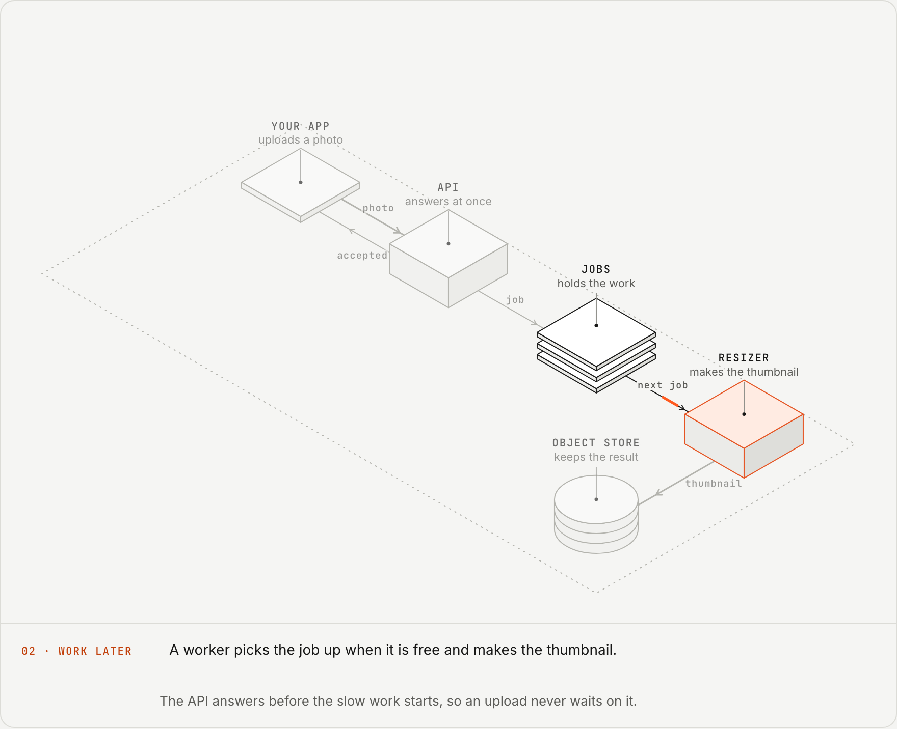
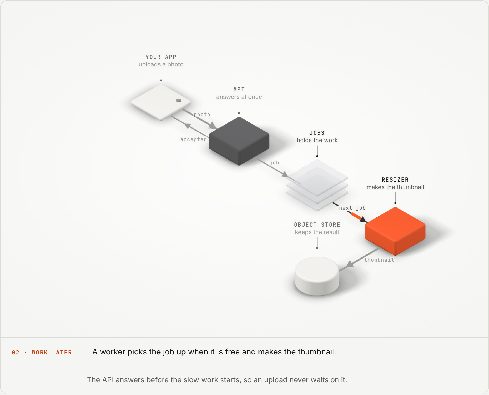

# docs

Docs that ship after the code ship wrong, and so does a diagram drawn once and
never again. This area makes them part of the change, the way a test is: user
docs and their screenshots, the README, a system map extracted from the code
and drawn on Miro, and animated figures of how a thing works.

It joins three areas that used to stand apart: docs-parity (user docs and the
README), system-map (the map and the Miro board), and picture-this (figures).
Each part below is what that area's own README said, with its routes by their
names here.

## User docs and the README

User docs drift for one reason: they ship after the code. A screen gets a new button on Tuesday, the docs
pass happens "later", and by then nobody remembers which three pages and which four screenshots showed the old
one. A careful docs sprint at the end does not fix this; it only moves the drift around. docs-parity makes the
docs part of the change, the way a test is: the commit that moves a button also rewrites the page that
describes it and retakes the picture that shows it, and a script checks that it did.

It works for any stack (web, desktop, CLI, Python, Rust, C++, Unreal Engine) and any docs target: a docs site,
a plain `docs/` folder of markdown, a GitHub or GitLab wiki, or a single README.

### How it works

**One rule, carried where it applies.** A project adopts the plugin with one file,
`.agents/docs-parity.json`. In that project a session-start hook gives the session one line: docs move in the
same change, screenshots come only from the capture harness, and the commit says `Docs: <pages>` or
`Docs: none, <why>`. The line comes back after a compaction or a `/clear`, and every sub-agent that acts gets
it too. Read-only agent types (a search, a planner) get nothing, and so does every project without the file.

**A writer contract.** Pages are split by reader into up to three roots (a Guide for users, Developers for
integrators, Admin for operators), each with a list of what it may and may not contain, and a public root never
links into a private one. Every page has the same frame: frontmatter where the target reads it, a two-to-four
sentence opening summary, one topic, a line budget, and its place in the nav manifest. Every command and flag
on a page was run before it was written. The project's copy lives at `.agents/docs-contract.md`, so nothing
written for agents lands in the user docs.

**Screenshots are code.** A picture is the output of a named shot in the project's capture harness, taken from
the built product on its own port with scratch data, a pinned clock, a fictional cast, faked third parties and
animations off; captured at 2x and shown at 1x; light and dark when the product themes; cropped, never scaled;
secrets masked. That is what lets a change retake exactly the pictures it made wrong. `capture-recipes.md` has
a harness per stack: Playwright for web and Electron, text-first output capture and VHS for terminals, an
automation test with `-RenderOffscreen` for Unreal, `QWidget::grab()` for Qt, simulator commands for mobile,
and executable examples for libraries with no UI.

**One checker.** `scripts/docs-check.mjs` (one file, Node standard library only, copyable into CI) checks what
a script can: images exist and have their dark twin, no image is orphaned, links resolve (markdown, MDX, and
wiki links), no public page leaks into a private root, the nav manifest and the pages agree, frontmatter,
summary, budget, and per-root deny patterns. With git it also maps code to docs: `--changed` reports a surface
whose code changed while its pages and shots did not, and `--stale` reports a shot taken before its surface's
code last changed. Exit 0, 1 or 2, so CI can gate on it.

**Told in session, failed in CI.** A Stop hook runs the checker on the working tree. When a turn's changes
left the docs behind it tells the agent, which gets one more go at the turn, and shows you one short line. The
same findings reach the agent once a session; after that only your line repeats. It never blocks. The same
script in CI fails the pull request.

<picture>
  <source media="(prefers-color-scheme: dark)" srcset="assets/figures/docs-move-with-code.dark.gif">
  
</picture>

**A README for people.** A README in a repo agents build fills up with prompts, rule restatements and
plumbing paths. `scripts/readme-check.mjs` holds one to 800 words, standard-readme's section order, and no
agent plumbing, and the `readme` skill rewrites one that fails, moving every sentence it cuts to
`CONTRIBUTING.md`, `docs/`, `AGENTS.md` or the changelog. It runs by hand anywhere; the Stop hook runs it on a
README a turn changed only where the config carries a `readme` block.

### Install

```
/plugin marketplace add NCMcClure/agentic-engineering
/plugin install agentic-engineering@agentic-engineering
```

Then, in a project, ask to adopt it ("set up the docs checks here"), which is the `init` route. Node 22 or newer is the only requirement; nothing is installed
into the project but the config and the contract, and a copy of the checker if you want it in CI.

Coming from 0.1: the config is read as it is. The writer contract moves from `.agents/contracts/docs.md` to
`.agents/docs-contract.md` at the next session start, and a `docs_check.py` your CI still runs keeps working
until you swap it for the Node copy.

### Routes

What was a skill here is a route of the `docs-parity` area of `agentic-engineering`. Ask for one in
words, or type `/agentic-engineering:start-here` and say what you want: the slash menu
holds that one entry, and an area cannot be typed. An agent reaches a route as
`/agentic-engineering:docs <route>`.

| Route | Started by | What it does |
|---|---|---|
| the area, with no route | the agent | The rule: what counts as user-visible, and which route to take. |
| `init` | you, by asking | Detects the stack and the docs target, then writes the config, with a first code-to-docs surface map, and the writer contract. Copies the checker in for CI on request. |
| `sync` | the agent | The in-loop pass: diff to pages and shots, rewrite, retake, check, and write the `Docs:` line. |
| `shots` | the agent | Builds or extends the capture harness to the shot contract. |
| `audit` | you, by asking, or the agent | Reads the whole docs set against the product and reports what drifted. Edits nothing. |
| `readme` | the agent | Rewrites a README to the skeleton and moves the rest to its proper home. |

### Works with

- **planning**: `build-tdd` updates docs in the same change for every `User-facing: yes` issue, and
  `build-user-docs` becomes the coherence pass over the whole set, both deferring to this contract.
- **agent-works**: owed harness work and audit fixes go on its kanban as cards.
- **perceptual-loop**: any capture harness can double as its render command, so its gates catch a docs picture
  that changed when nothing should have, and `calibrate` measures whether two runs of a shot agree.
- **writing**: carries the prose voice when installed.

Each is optional; docs-parity runs alone.

## The system map

An architecture diagram is true on the day it is drawn. After that the code
moves and the picture does not, and nobody finds out until a new person
trusts it. system-map moves the diagram into the code: each module declares
what it is and whom it calls, the map is extracted from those lines into a
committed file, and a checker holds that file to the real import graph. A map
that has fallen behind fails a check instead of waiting to mislead someone.

The map still has to be drawn where people will look, and that place is a
Miro board. A diagram an agent puts on one is rarely one a person can read:
captions stack on shared connectors, a "straight" line draws diagonally, text
spills out of its card. So what reaches the board is linted like code.

### How the map works

<picture>
  <source media="(prefers-color-scheme: dark)" srcset="assets/figures/map-true-to-code.dark.gif">
  
</picture>

**The code declares its own shape.** Each module says what it is and whom it
calls in comment lines:

```js
// @system node intake "Intake" layer=service
// @system calls queue "hands on approved request"
// @system exposes take "takes one request and checks it"
```

**The map is a committed file.** `scripts/system-map.mjs` extracts those lines
into `diagrams/system-map.json`, committed beside the code and reviewed as a
diff. A new module or a new call between modules gets its line in the same
commit, so a reviewer reads the change to the architecture next to the change
to the code.

**The check reads the code, not the map.** The real import graph (JS/TS and
Python) and the scripts a module runs as child processes must each have a
`calls` line, every directory of source files belongs to a node, calls go down
the layers, network calls live in adapters, and every export of an entry file
is classified. A stale map is `MAP_STALE`; an import nobody declared is
`UNDECLARED_IMPORT`. An import that deliberately needs no edge takes
`Diagram: none, <why>` in the commit message. The grammar and every finding
are in `routes/map-sync/references/grammar.md`.

**Told in session, failed in CI.** A Stop hook runs the checker on what a
turn changed since the last commit. When the turn left the map behind, the
agent is told the finding, the file and the line, gets one more go at the
turn, and you see one short line. The same findings reach the agent once a
session; after that only your line repeats. It never blocks, and a board that
is behind the map is never raised there: publishing is yours to ask for. The
same script in CI fails the pull request.

**The sweep covers what one change does not.** The check follows a change.
The whole-repo sweep reads every module's annotations against its code,
including what no checker can judge: a label that says nothing, an HTTP call
nobody declared, a module on the wrong layer. `scripts/map-sweep.mjs` sizes
the repo first. A small one is read in one session; a large one (8 or more
modules, or 150 or more source files) fans out a writer and a reviewer per
module, and only after you say yes.

The map needs Node and nothing else. A repo can adopt it and never touch a
board.

### Where it is drawn

On Miro, from code. A project keeps a `miro.config.mjs` that names the board
and lists its frames. Each frame comes from a generator, a small module that
receives a drawing kit and returns a scene of cards, text, and arrows. The
system map's generator is one line, and any other diagram or flow can be a
frame beside it.

<picture>
  
</picture>

The example frame a new project starts with, drawn from the build's SVG with
the routes and captions the lint predicts for Miro: neutrals carry the frame,
and a color only tells one kind of card from another.

1. **Build.** Each scene becomes Miro SVG, and the build writes nothing while
   the legibility lint finds overflowing text, collisions, crossed or diagonal
   connectors, captions longer than their run, or cards across a border. Each
   check encodes how Miro really draws (`routes/miro/references/how-miro-draws.md`).
2. **Publish.** The files go to the board through the Miro MCP.
3. **Live check.** Miro's read does not return connector routes or caption
   positions, so a script run in the board's browser tab dumps what Miro
   actually drew, and the same lint reads it.
4. **Pull.** The board's layout comes back into `miro/<frame>.layout.json`, so
   a card someone dragged in Miro survives the next build. Content changes in
   code; layout may change on the board.

<picture>
  <source media="(prefers-color-scheme: dark)" srcset="assets/figures/repo-and-board.dark.gif">
  
</picture>

**Two lines stay in the agent's context**, in a repo that has opted in to the
agentic-engineering plugins and carries a system map or a `miro.config.mjs`:
annotate a new module or call in the same commit, and lint before publishing
and check live after. They come back after a compaction or a `/clear` and
reach subagents that write code. In a repo with a Miro project, the session
also says one line when the machine lacks what the live check needs.

Node 22, no dependencies of its own. The scripts read files and git; only the
publish and the live check reach Miro, and they go through your sessions.

### Credentials

The plugin holds none, and asks for none.

- **Publishing** goes through the Miro MCP you connect yourself (the Miro
  connector, or `claude mcp add --transport http miro https://mcp.miro.com/`).
  Its sign-in is between you and Miro; no script here sees a token, and there
  is no API key to set.
- **The live check** drives a Chrome window through the bundled `miro-browser`
  server (chrome-devtools-mcp, pinned to one version, fetched by `npx` on first
  start). That Chrome uses a profile of its own under
  `~/.cache/system-map/chrome-profile`, and you sign in to Miro there once,
  yourself. The agent never types a password, and no script reads the profile.
- **The repo** gets a board URL and item ids (`miro/board.json`,
  `.agents/system-map.json`), nothing that grants access. Who can see a board
  is set in Miro, by you.

Nothing assumes a Miro organisation, team, or space: you name the board, or
ask for a new one. A repo whose boards must carry a classification label
before anything lands on them can set `requireClassification` in
`.agents/system-map.json`; the publish gate then refuses until the label is
recorded as confirmed.

### Install

```text
/plugin marketplace add NCMcClure/agentic-engineering
/plugin install agentic-engineering@agentic-engineering
```

Start a new session after installing. The map and its check need Node 22 and
nothing else. Drawing it on a board also needs:

- Node 22.12 or newer (20.19 also works for the browser server), with npx.
- Google Chrome, for the live check.
- The Miro MCP connected, for publishing.

The `browser-setup` route, which you ask for, checks the machine and gets the browser
connected.

This plugin replaces `marvelous-miro`: the same scripts and skills under a
name that says what they are for. If you had that one installed, uninstall it
and install this one; it will not update in place. A repo that adopted the
map needs no change, and a Chrome profile you signed in to Miro with under
`~/.cache/marvelous-miro/` stays the one in use. A checker copied into a repo
for CI keeps working, and names the old slash commands in two of its messages
until it is copied in again.

### Routes

What was a skill here is a route of the `system-map` area of `agentic-engineering`. Ask for one in
words, or type `/agentic-engineering:start-here` and say what you want: the slash menu
holds that one entry, and an area cannot be typed. An agent reaches a route as
`/agentic-engineering:docs <route>`.

| Route | Started by | Does |
|---|---|---|
| `map-init` | you, by asking (`[board name or URL]`) | Once per repo: proposes the `@system` annotations from the import graph, writes `.agents/system-map.json` and the committed map, records the board, publishes the first frame, and on request copies the checker in for CI. |
| `map-sync` | the agent | Brings the map and the board level with a change: reads the checker's findings, fixes the annotations, regenerates the map, republishes. Also the whole-repo sweep, which fans out a writer and a reviewer per module in a large repo. |
| `miro` | the agent | Starts a Miro project, then runs the build, publish, live check, and pull loop for any frame drawn from code. |
| `browser-setup` | you, by asking | Checks Node, npx, and Chrome, connects the bundled browser server on the current surface, and waits while you sign in to Miro once. |

### The check, by hand and in CI

The Stop hook runs the second of these for you, in a repo that carries
`.agents/system-map.json`:

```bash
node <plugin root>/scripts/system-map.mjs                  # check the whole repo
node <plugin root>/scripts/system-map.mjs --changed HEAD   # only what this change touched
node <plugin root>/scripts/system-map.mjs --write          # regenerate the map, then check
```

It exits 0 clean, 1 on a warning, 2 when it cannot run, and `--json` prints
the findings for a machine. The script is one file with no imports of its own,
so `map-init` can copy it to `.agents/scripts/system-map.mjs` for a
pipeline step. A repo without `.agents/system-map.json` is untouched.

### Where it does not reach

The live check needs a local browser, so a cloud or remote session can build,
lint, and publish, but says the live check did not run. The import cross-check
reads JS/TS and Python; modules in other languages are declared by annotation
alone. Calls the checker cannot see (HTTP, queues, events, a script path built
at runtime) are found by reading the code, which is what the sweep's reviewers
are for.

## Figures

A system that takes three paragraphs to explain usually takes one good picture.
Drawing that picture is the hard part, so most docs settle for the paragraphs.

This plugin draws it. Describe how something works, or point at a feature in
your codebase, and it comes back with three rough animated drafts, each a
different picture designed from that subject. You pick one, it gets finished, and you end
up with a React component that drops into MDX, and pictures of it for a plain
README: a still, a strip of its steps, or a looping GIF.

<picture>
  <source media="(prefers-color-scheme: dark)" srcset="assets/iso-flow.dark.png">
  
</picture>

That picture is one frame of the plugin's worked example, taken by the plugin.
Live, it plays: the pulse travels, the story moves on to the next beat, and a
strip under it pauses, steps, and scrubs. Its source is `studies/iso-flow/`.

The same model, the same layout, drawn in 3D (`studies/iso-flow-3d/`):

<picture>
  <source media="(prefers-color-scheme: dark)" srcset="assets/iso-flow-3d.dark.png">
  
</picture>

### How it works

Before anything else comes the **lens**. Not every subject is boxes with
arrows: a device is parts inside a case, a pipeline is work stepping through
stages in time, a blur is a number spread over a grid, a lock is five gaps
that must line up at once. Four questions about the subject say which
of eight lenses leads (structure, path, time, field, transformation,
difference, cases, scale), and where a second one goes when the subject
needs two.

Then the **model**: what the subject is made of, what is inside what, what
passes or changes, how much, and the beats of the story, saved as
`model.json` beside the figure. When the model comes from code, each entry
carries the file and line it was read from, and you approve it before
anything is drawn.

The three drafts all draw that one model, each as a different **view**: what
the page is, what each axis and each mark means, what moves. A view is
designed from the subject and stated in words before it is drawn, so you
read what each draft set out to show beside what it shows. Before you see
them, each draft is checked for defects, tested for being a stock diagram
with new labels on it, and shown, without captions, to a reader that knows
nothing about your system. What that reader understood is reported beside
the draft.

The plugin ships no templates. It ships a **vocabulary**: boxes, bars and
tiles, connectors, tokens, meters, ruled axes, grids of cells, isometric
slabs, blocks, drums and wires. A shape is in the kit only if figures of
unrelated subjects reached for it; what one subject alone needs (a key, a
gear, a globe) is drawn in that figure. And it ships
**studies**: thirteen worked figures, at least one for each lens (a flow, a
layer stack, a time grid, a field of cells, a sort, a scale model) to learn
a technique from. A draft starts on a
blank stage unless a study's view is exactly the view the subject wants.

The look is one **house style**: monochrome with a single orange accent,
hairline line art, flat or isometric as the subject calls for, flat upright
labels. It ships as a small **kit**
that is copied into your repo and is yours from then on: plain CSS, React, no
animation library.

Two studies draw in **3D**: the same isometric framing in matte clay,
frosted glass and soft shadow, on React Three Fiber. A 3D figure reads the
same clock and the same model, and its labels stay flat. Drafts and stills
cost your repo nothing, since the studio has three.js; showing one live in a
site needs three packages there, and the plugin asks before it adds them.

A figure is drawn as a function of one **clock**. It plays when it scrolls
into view, loops, and has a strip to pause, scrub, or step. Because any
instant can be reproduced, the still in your README is an exact frame of the
live figure, not a screenshot taken at a lucky moment. The same goes for the
other two README exports. The **beat strip** lays every step side by side,
each held at its middle. The **looping GIF** is one frame for each instant of
a loop, photographed with the clock held there: nothing is recorded, so it
comes out the same every time, on any machine.

Rendering happens in a **studio**: a Vite app and a headless browser that the
plugin installs once into its own data folder, never into your project. The
plugin itself is plain Node with no dependencies.

### Install

```text
/plugin marketplace add NCMcClure/agentic-engineering
/plugin install agentic-engineering@agentic-engineering
```

The first figure installs the studio: Node 20+, network access, and a headless
browser (about 100 MB to download), once. It asks before it downloads anything.
After an update that changes the studio's packages it asks once more.

This area replaces `animated-storytelling`, which the catalog no longer lists:
if it is still installed, uninstall it.

### Routes

What was a skill here is a route of the `picture-this` area of `agentic-engineering`. Ask for one in
words, or type `/agentic-engineering:start-here` and say what you want: the slash menu
holds that one entry, and an area cannot be typed. An agent reaches a route as
`/agentic-engineering:docs <route>`.

| Route | What it does |
|---|---|
| `figure` | Finds the lens, models the subject from a description or from code, drafts three views designed from it, refines the one you pick, and places the component and its model in your repo. |
| `stills` | Captures a figure for a README and hands back the snippet that shows it: light and dark PNGs of its hero frame, a beat strip of every step in one row, or a looping GIF. |

Or just ask: "visualize how the job queue works", "diagram this feature for
someone non-technical", "the README needs a picture of the sync flow".

### Honesty box

- The kit is React. Figures embed in MDX on fumadocs or any React site; other
  targets get the stills only.
- A still taken in the studio uses the studio's fonts, so it matches your
  live docs in geometry, not in typeface.
- The cold read is a model looking at a picture. It catches a figure that
  does not explain itself; it is not a substitute for showing a person.
- A GIF is the costly export. It is 256 colours at one pixel per pixel, so
  it is rougher than the live figure, and every reader downloads all of it.
  The defaults keep it small (720 px wide, 15 frames a second, one loop: the
  worked example is 549 KB), the size is printed every time, a GIF past 5 MB
  comes with a warning, and one past GitHub's 10 MB is not written.
- A beat strip is one row, so a README shrinks it: its captions are sized to
  survive that, the labels inside each small picture are not.
- 3D is code-built, not modelled: it gets matte clay, frosted glass and soft
  shadows right, and has no bounce light, glow, or glass that bends what is
  behind it.
- A 3D figure adds `three`, `@react-three/fiber` and `@react-three/drei` to
  the site that shows it live: about 165 MB in `node_modules` with what they
  depend on. Its stills need none of them.

## History

This area joins three plugins that once stood alone. Their changelogs are kept
as they were: [docs-parity](history/docs-parity.md),
[system-map](history/system-map.md), and [picture-this](history/picture-this.md).
