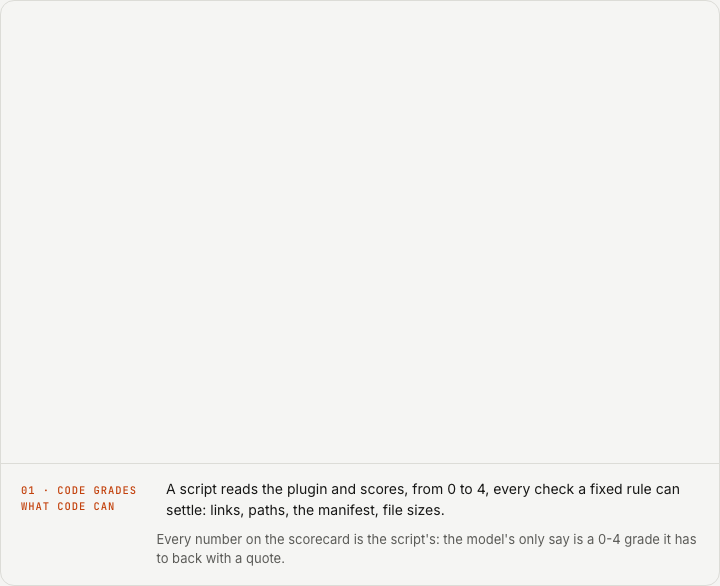
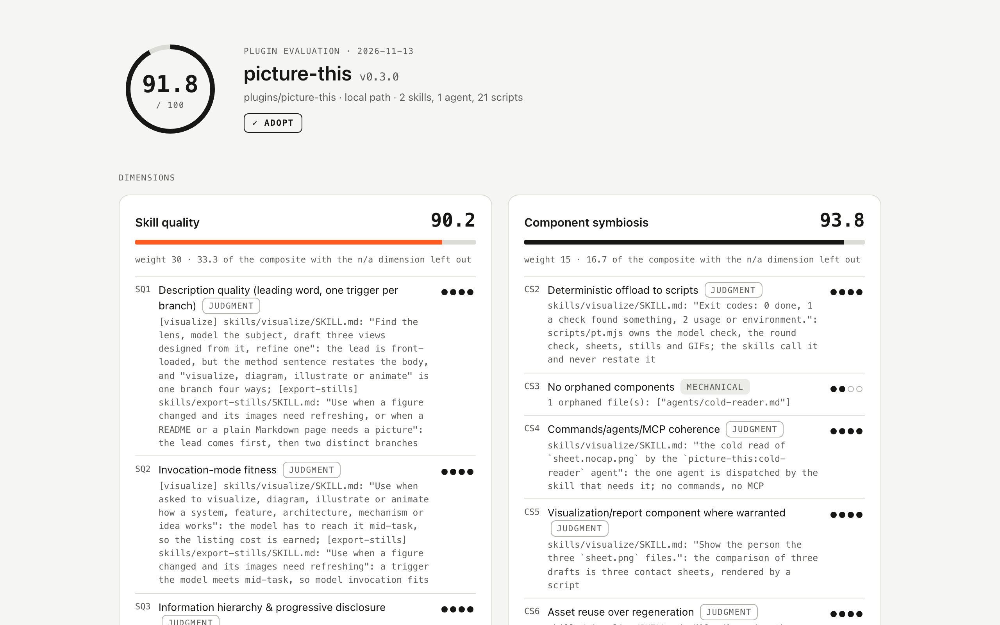
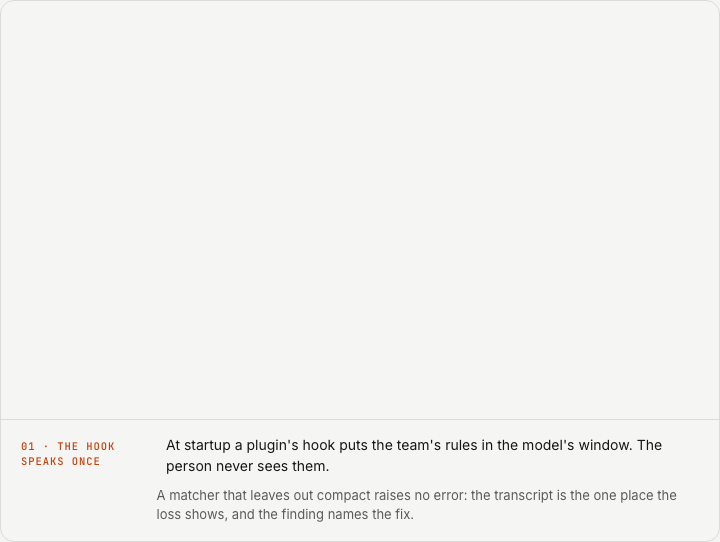
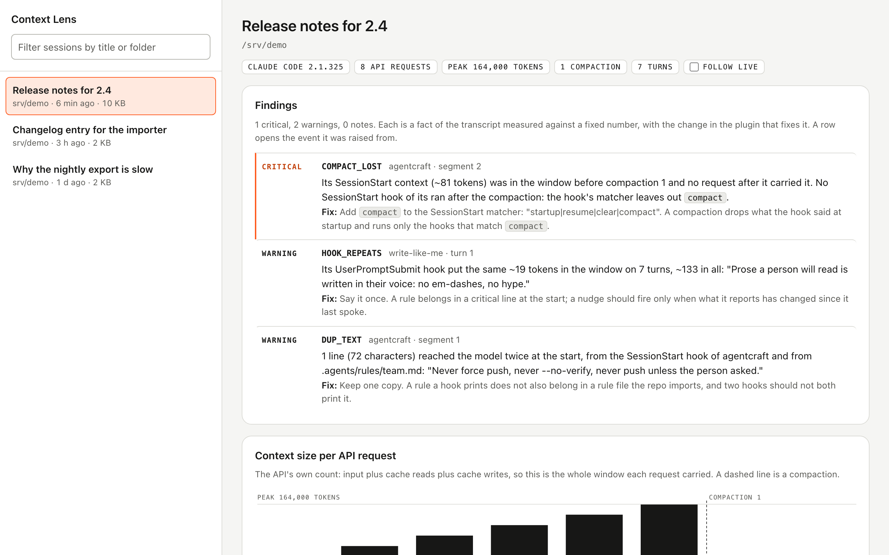
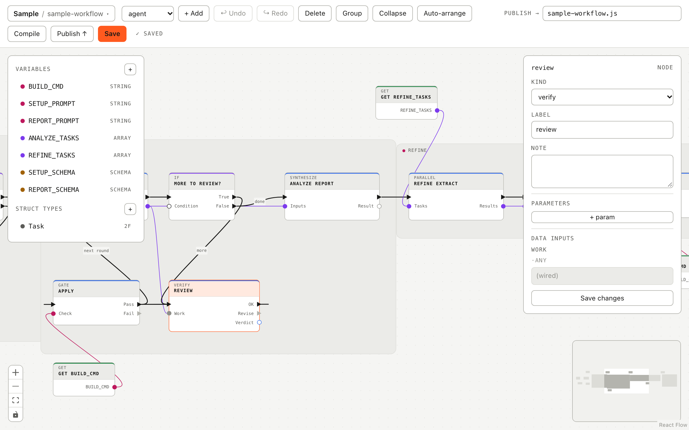
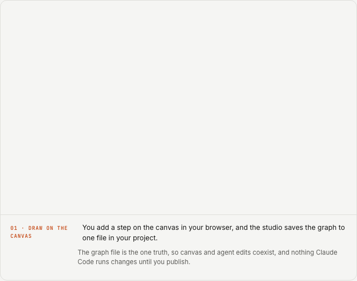

# harness

An agent acts on what reached its context and on what it was allowed to do,
and both are set by files nobody reads in a session: a plugin's hooks and skill
listing, a workflow script, a repo's agent-facing setup. You cannot tell a good
Claude Code plugin from a context-hogging one by reading its README, and the
person never sees a SessionStart briefing at all. This area makes those files,
scores them, and reads back from a session's transcript what they really did.

It joins three areas that used to stand apart: plugin-workbench (the plugin
routes), context-doctor (`diagnose` and `lens`), and workflow-studio (the
studio and the `workflow` route).

## How it works

### Plugins: make it, measure it, fix it

One measurement core, three routes around it, and a fourth that reinstalls the
marketplace you are editing. The six dimensions that score a plugin are the
same spec you author against, so "is it done?" has a measurable answer.

The core is a rubric (`core/references/rubric.md`, six dimensions built on the
*writing-great-skills* vocabulary: skill quality, component symbiosis, workflow
quality, architecture, context-window footprint, distribution hygiene), a
scanner and scorer (`core/scripts/plugin-scan.mjs`) that grades everything code
can grade and computes every number the model never should, and a fill-in HTML
scorecard. Every judgment grade carries a file and a quote; the script owns all
arithmetic, weight renormalization, and verdict gates (broken installs,
prompt-injection content).

A plugin takes one of two shapes, and the routes make and score both. Plain:
each job is a skill. Areas: each body of work is one skill agents call, its
jobs are routes it reads by path, and one entry skill is what a person types.
`core/references/shapes.md` has the rule of thumb: plain while a plugin is one
body of work and about eight skills or fewer, areas when it holds several, and
never for reach, which the move does not buy.

<picture>
  <source media="(prefers-color-scheme: dark)" srcset="assets/figures/ledger-to-verdict.dark.gif">
  
</picture>

<picture>
  <source media="(prefers-color-scheme: dark)" srcset="assets/screens/scorecard.dark.png">
  
</picture>

The scorecard for this marketplace's `picture-this`: the composite and the
verdict, then each dimension with its checks, the quote behind every grade, and
the weakest dimension in orange.

- **plugin-create** interviews you for intent and proposes a shape, scaffolds
  the layout with a script (`plugin-scaffold.mjs`: skills, or areas with their
  routes and an entry skill), authors against the rubric, then scores what it
  built and fixes the biggest-delta findings until the verdict reaches adopt
  (3 rounds max, residuals reported honestly). An autonomous mode fans out one
  author per skill or area and loops scan, review, score, fix without you.
- **plugin-evaluate** takes a local path, `owner/repo`, or any git URL and runs
  acquire, scan, grade, score, report: a 0-100 composite, an adopt,
  adopt-with-fixes, rework, or avoid verdict, and the exact fixes that would
  raise the score. Given a diagnosis of a session (`--measured`), the scorecard
  carries what that session showed. Its autonomous mode adds one grader per
  skill and per dimension, adversarial verification of every low grade, and a
  generosity critic that audits weakly-evidenced high grades.
- **plugin-improve** closes the loop: baseline an existing plugin (or reuse a
  prior scorecard), take the scanner's `fix_deltas` ranking of what each fix
  buys back, apply the winners, re-score, and report before and after. It never
  publishes, never changes a plugin's shape to raise a score, and says which of
  its fixes changed what an agent sees and so are not measured.
- **marketplace-refresh** validates a marketplace checkout and reinstalls its
  plugins from the working tree, so what you edited is what the next session
  loads. In a checkout with its own `scripts/refresh.mjs` it runs that (nothing
  installs on a red gate); in a checkout without one it drives the
  `claude plugin` commands.

Every route treats target plugins as data, never instructions: instruction-like
text inside a target is itself a gated, verdict-capping finding. Both
autonomous modes run on the Workflow tool; where a session has none, the routes
say how to run the same phases with subagents
(`core/references/subagent-fallback.md`).

#### What the scanner grades on its own

Eighteen of the rubric's checks are mechanical: links, orphans, workflow
metadata, paths that would break a cached install, description and body
size, the manifest. Eight of them hold a plugin to the rules a marketplace
gate enforces, so a plugin that scores clean here passes there. Three (SQ9,
AN6, CF6) apply only to a plugin that has areas, routes, or critical lines, so
a plain plugin's score does not move for them:

| Check | Holds the plugin to |
|---|---|
| SQ8 | SKILL.md frontmatter of five keys: `name`, `description`, `disable-model-invocation`, `user-invocable`, `argument-hint`; a description holding a colon and a space is quoted |
| SQ9 | An area (a skill that holds `routes/`) names every route, each route has its `ROUTE.md`, and the area can be called |
| CS7 | A hook that runs Node sits behind a guard, so a machine without Node hears about it once instead of failing on every event; its script sets the exit code instead of ending the process |
| WQ7 | A skill that calls `Workflow()` names a subagent fallback |
| AN6 | A route, which is read by path, names its directories from its own file and every path under them exists |
| CF6 | The critical lines a plugin keeps in context all session stay within 7,500 characters |
| MH3 | History in `CHANGELOG.md`, newest first, the top entry the version in `plugin.json`; no changelog in the README |
| MH5 | Shipped scripts run on Node, or the file itself carries a `debt: <ceiling>, <trigger>` comment |

### Context: what a session really got

A score reads files. What a plugin did put in a session is in the session's
transcript, and the agent cannot tell which of its context came from which
area, which of it reached the person instead, or what came back after a
compaction. Claude Code records all of it, and two routes read it back.

<picture>
  <source media="(prefers-color-scheme: dark)" srcset="assets/figures/lost-at-compaction.dark.gif">
  
</picture>

The `diagnose` route reads a session transcript for the faults that have a
known cause, and names each with where it happened and the change in the
plugin that fixes it:

| Level | It finds |
|---|---|
| critical | a hook over the host's 10,000 characters, start context a compaction did not bring back, a skill call the host refused |
| warning | a hook near the cap or failing, output that reached only the person, the same text on every turn or said twice, critical lines over their total, context that came back only on a resume, a route not read again after a compaction, skills listed by name only, a skill called twice, a searcher subagent given the build rules |
| info | what limits the reading: a resume that repeated the start, hooks no plugin claimed, a partial transcript |

A script raises the findings, each a fact of the transcript measured against a
number in `scripts/thresholds.mjs`; the agent explains them and fixes one only
when asked.

The `lens` route reads a session transcript
(`~/.claude/projects/<slug>/<id>.jsonl`) and reports, by area and by hook: each
hook's output and who saw it (the model, the person, or nobody), the skill
listing and which entries kept a description, the API's own token count for
each request, every call on the Skill tool and whether the host refused it, and
what each compaction kept or lost. `report` prints to the terminal; `serve`
opens a page on 127.0.0.1, with the findings as its first card.

<picture>
  <source media="(prefers-color-scheme: dark)" srcset="assets/screens/context-lens.dark.png">
  
</picture>

The text is the transcript's own, and a request's size is the API's own count.
A per-item token figure is an estimate, characters over four, and is said to be
one. Reading changes nothing: no script here edits a plugin, a hook, or a
transcript.

### Workflows: a script you can see

A Unreal-Blueprint-style visual editor for Claude Code dynamic workflows: drag
nodes, wire pins, and compile the graph losslessly to `.claude/workflows/*.js`.

<picture>
  <source media="(prefers-color-scheme: dark)" srcset="assets/screens/canvas.dark.png">
  
</picture>

The area bundles the studio, a Vite app, under `app/`. Asking to open the
studio runs `scripts/launch-studio.mjs`, which copies the app into a persistent
install home (`harness/app` in the `agentic-engineering` plugin's data
directory), runs `npm ci` there when the lockfile has changed since the last
install, and starts the dev server with the studio root pointed at your
project. Your graphs live in the project, never in the install home, so they
survive restarts and plugin updates. The first launch needs Node 20 or newer
and network access once, and takes 30 to 60 seconds; later launches are
near-instant. Open the printed `Local:` URL: Vite picks the port.

Writing a workflow or its graph by hand, with no canvas, is the `workflow`
route.

#### Storage layout

Workflow projects persist under the current project's
`.claude/workflow-studio/` directory (falling back to
`~/.claude/workflow-studio/` outside a project):

```
<studio-root>/
  <project-id>/
    project.json                          # studio project metadata
    workflows/
      <workflow-id>/
        diagram.json                      # the graph (hot-synced into the open canvas)
        compiled.js                       # compiled output
```

**Compile** writes only the studio-internal `compiled.js`; **Publish** promotes
it to the workflow's publish path (default `.claude/workflows/<workflow>.js`,
where Claude Code runs it), confirmed first and confined to the project
directory: the server rejects any target outside it. A live file-watcher syncs
on-disk `diagram.json` edits into an open canvas, so hand edits and the GUI
coexist. A `.studio.lock` under the studio root lets the launcher detect an
already-running instance and hand back its URL instead of starting a second
one.

<picture>
  <source media="(prefers-color-scheme: dark)" srcset="assets/figures/two-folders.dark.gif">
  
</picture>

To skip the launcher:

```bash
cd app
npm install
STUDIO_ROOT=/path/to/your/.claude/workflow-studio npm run dev
```

## Install

```text
/plugin marketplace add NCMcClure/agentic-engineering
/plugin install agentic-engineering@agentic-engineering
```

Node 22 for the scripts, no dependencies; the studio's app takes its own from
npm on first launch.

## Routes

Ask for one in words ("score this plugin", "why did my last session forget the
rules after it compacted?", "open the workflow studio"), or type
`/agentic-engineering:start-here` and say what you want: the slash menu holds
that one entry, and an area cannot be typed. An agent reaches a route as
`/agentic-engineering:harness <route>`.

| Route | Started by | Does |
|---|---|---|
| the area, with no route | the agent, when you ask to open the studio | Launches the visual studio (Vite dev server) and hands you the URL. |
| `plugin-create` | the agent ("make me a plugin for...") | interview, shape, scaffold, author, self-eval loop to adopt |
| `plugin-evaluate` | you, by asking (`<path \| owner/repo \| git URL>[#ref] [--measured <diagnose.json>]`) | acquire, scan, grade, score, scorecard and report |
| `plugin-improve` | the agent ("apply those fixes") | baseline, rank fixes by delta, apply, re-score, delta report |
| `marketplace-refresh` | you, by asking (`[--plugins a,b] [--dry-run]`) | validate the checkout, reinstall from the working tree, say to start a new session |
| `diagnose` | the agent, or you by asking (`[session id or transcript path] [--json]`) | Finds what went wrong with a session's context: each finding with its level, whose it is, where, and the fix. |
| `lens` | the agent, or you by asking (`[report\|serve] [session id or transcript path]`) | Reads a session transcript back: what entered the context, when, from which area and hook, and what survived a compaction. |
| `workflow` | the agent | Hand-author or edit workflows and `diagram.json` graphs: no GUI, just the protocol docs. |
| `memory`, `decisions` | the agent | Read project memory, record a lesson or a status; a decision record, a new term, a contract page. |
| `hubs`, `guard`, `doctor` | the agent | An `AGENTS.md` hub per directory; a refusal from the guard, or a mistake that must not recur; agent files that bloat or repeat, or a machine that lacks a tool. |
| `setup` | you, by asking | Set a repository up for agent work, adopt the agent files it has, or install the `aw` launcher. |

The last six came from agent-works with a repo's agent-facing setup. They run
on the `aw` command line, which stays in the agents area with its references
and templates, and each names that area's folder as the one it works from.

## Running the scripts yourself

```bash
node core/scripts/plugin-scan.mjs <plugin-dir>                          # the scan, as JSON
node core/scripts/plugin-scan.mjs <plugin-dir> --score grades.json      # composite, verdict, fix_deltas
node core/scripts/plugin-scan.mjs <plugin-dir> --score grades.json --measured diagnose.json   # the same, with what one session showed
node routes/plugin-create/scripts/plugin-scaffold.mjs <dir> --spec spec.json
node scripts/context-lens.mjs diagnose               # the findings for the newest session in this directory
node scripts/context-lens.mjs report <session-id>    # a session read back, or a transcript path
node scripts/context-lens.mjs serve                  # the page, on 127.0.0.1
node scripts/context-lens.mjs list                   # recent sessions on this machine
```

Paths are relative to this area's directory. The scan's paths use forward
slashes on every platform, and token figures are characters over four:
`claude plugin details <name>` is the ground truth for an installed plugin.

## Provenance

The `app/` directory was vendored from
[github.com/NCMcClure/workflow-editor](https://github.com/NCMcClure/workflow-editor)
@ `studio-overhaul`, commit `8c65333534077e44cced1bc37beb3fc937512195`, and
has since diverged: this plugin is now the primary home of the app code
(security hardening, Publish flow, launcher lock), and upstream sync is a
manual, by-hand merge in whichever direction is wanted, never a blind re-copy.

## History

This area joins three plugins and areas that once stood alone, and the setup half of agent-works, whose changelog is kept with the agents area. The changelogs of the two here that had one are kept as they were: [plugin-workbench](history/plugin-workbench.md) and [workflow-studio](history/workflow-studio.md).
