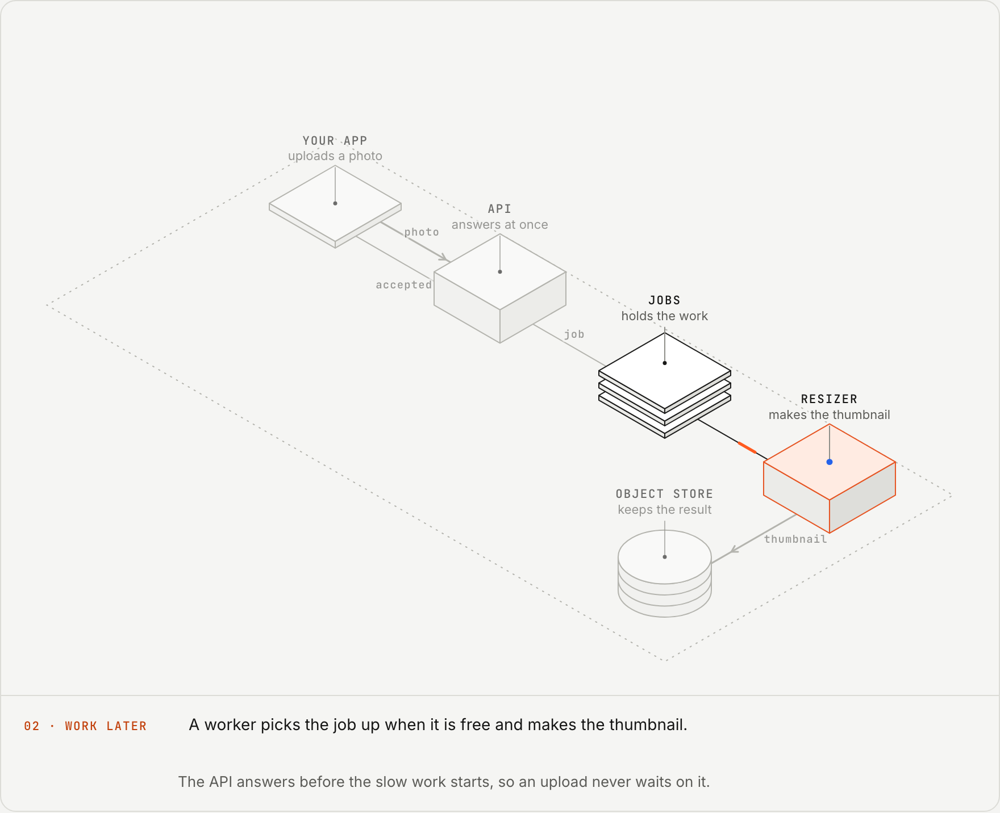

# Picture This

A system that takes three paragraphs to explain usually takes one good picture.
Drawing that picture is the hard part, so most docs settle for the paragraphs.

This plugin draws it. Describe a system, or point at a feature in your
codebase, and it comes back with three rough animated drafts of how it works,
each a different kind of picture. You pick one, it gets finished, and you end
up with a React component that drops into MDX and a pair of images for a
plain README.

<picture>
  <source media="(prefers-color-scheme: dark)" srcset="assets/iso-flow.dark.png">
  
</picture>

That picture is one frame of the plugin's worked example, taken by the plugin.
Live, it plays: the pulse travels, the story moves on to the next beat, and a
strip under it pauses, steps, and scrubs. Its source is `starters/iso-flow/`.

## How it works

Every figure starts as a **model**: the entities, the flows between them, and
the beats of the story, saved as `model.json` beside the figure. When the
model comes from code, each entry carries the file and line it was read from,
and you approve it before anything is drawn.

The three drafts all draw that one model, each on a different **archetype**
(a flow with travelling pulses, a lifted layer stack, a staged build-up, and
so on), so you compare forms and not decoration. Before you see them, each
draft is checked for defects and shown, without captions, to a reader that
knows nothing about your system. What that reader understood is reported
beside the draft.

The look is one **house style**: monochrome with a single orange accent,
hairline isometric line art, flat upright labels. It ships as a small **kit**
that is copied into your repo and is yours from then on: plain CSS, React, no
animation library.

A figure is drawn as a function of one **clock**. It plays when it scrolls
into view, loops, and has a strip to pause, scrub, or step. Because any
instant can be reproduced, the still in your README is an exact frame of the
live figure, not a screenshot taken at a lucky moment.

Rendering happens in a **studio**: a Vite app and a headless browser that the
plugin installs once into its own data folder, never into your project. The
plugin itself is plain Node with no dependencies.

## Install

```text
/plugin marketplace add NCMcClure/agentic-engineering
/plugin install picture-this@agentic-engineering
```

The first figure installs the studio: Node 20+, network access, and a headless
browser (about 100 MB to download), once. It asks before it downloads anything.

This plugin replaces `animated-storytelling`. If you had that one installed,
uninstall it and install this one; it will not update in place.

## Skills

| Skill | What it does |
|---|---|
| `/picture-this:visualize` | Models a system from a description or from code, drafts three variations, refines the one you pick, and places the component and its model in your repo. |
| `/picture-this:export-stills` | Captures a figure's hero frame as light and dark PNGs and hands back the snippet that shows the right one in a README. |

Or just ask: "visualize how the job queue works", "diagram this feature for
someone non-technical", "the README needs a picture of the sync flow".

## Honesty box

- The kit is React. Figures embed in MDX on fumadocs or any React site; other
  targets get the stills only.
- A still taken in the studio uses the studio's fonts, so it matches your
  live docs in geometry, not in typeface.
- The cold read is a model looking at a picture. It catches a figure that
  does not explain itself; it is not a substitute for showing a person.
- This release is 2D. Lit 3D scenes and an animated README export come later.
