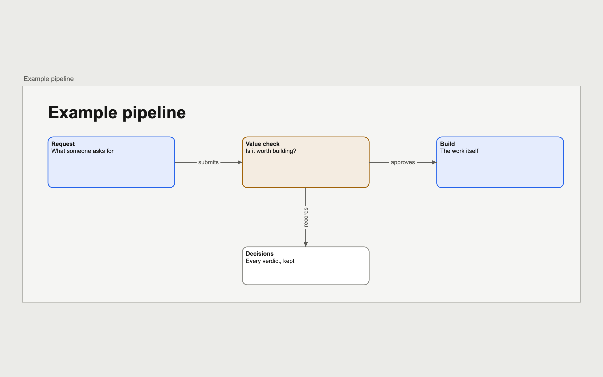
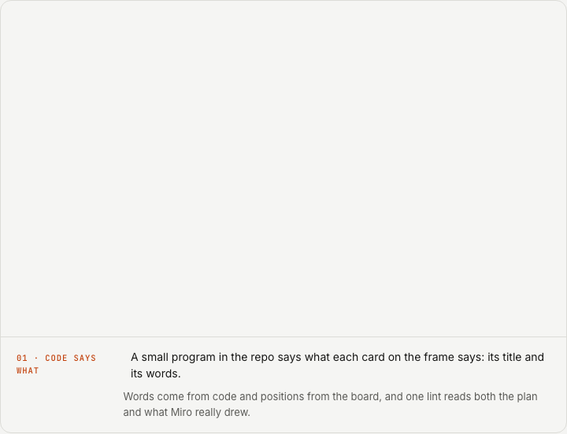

# system-map

An architecture diagram is true on the day it is drawn. After that the code
moves and the picture does not, and nobody finds out until a new person
trusts it. system-map moves the diagram into the code: each module declares
what it is and whom it calls, the map is extracted from those lines into a
committed file, and a checker holds that file to the real import graph. A map
that has fallen behind fails a check instead of waiting to mislead someone.

The map still has to be drawn where people will look, and that place is a
Miro board. A diagram an agent puts on one is rarely one a person can read:
captions stack on shared connectors, a "straight" line draws diagonally, text
spills out of its card. So what reaches the board is linted like code.

## How the map works

**The code declares its own shape.** Each module says what it is and whom it
calls in comment lines:

```js
// @system node intake "Intake" layer=service
// @system calls queue "hands on approved request"
// @system exposes take "takes one request and checks it"
```

**The map is a committed file.** `scripts/system-map.mjs` extracts those lines
into `diagrams/system-map.json`, committed beside the code and reviewed as a
diff. A new module or a new call between modules gets its line in the same
commit, so a reviewer reads the change to the architecture next to the change
to the code.

**The check reads the code, not the map.** The real import graph (JS/TS and
Python) and the scripts a module runs as child processes must each have a
`calls` line, every directory of source files belongs to a node, calls go down
the layers, network calls live in adapters, and every export of an entry file
is classified. A stale map is `MAP_STALE`; an import nobody declared is
`UNDECLARED_IMPORT`. An import that deliberately needs no edge takes
`Diagram: none, <why>` in the commit message. The grammar and every finding
are in `skills/diagrams-sync/references/grammar.md`.

**The sweep covers what one change does not.** The check follows a change.
The whole-repo sweep reads every module's annotations against its code,
including what no checker can judge: a label that says nothing, an HTTP call
nobody declared, a module on the wrong layer. `scripts/map-sweep.mjs` sizes
the repo first. A small one is read in one session; a large one (8 or more
modules, or 150 or more source files) fans out a writer and a reviewer per
module, and only after you say yes.

The map needs Node and nothing else. A repo can adopt it and never touch a
board.

## Where it is drawn

On Miro, from code. A project keeps a `miro.config.mjs` that names the board
and lists its frames. Each frame comes from a generator, a small module that
receives a drawing kit and returns a scene of cards, text, and arrows. The
system map's generator is one line, and any other diagram or flow can be a
frame beside it.

<picture>
  
</picture>

The example frame a new project starts with, drawn from the build's SVG with
the routes and captions the lint predicts for Miro: neutrals carry the frame,
and a color only tells one kind of card from another.

1. **Build.** Each scene becomes Miro SVG, and the build writes nothing while
   the legibility lint finds overflowing text, collisions, crossed or diagonal
   connectors, captions longer than their run, or cards across a border. Each
   check encodes how Miro really draws (`skills/miro-board/references/how-miro-draws.md`).
2. **Publish.** The files go to the board through the Miro MCP.
3. **Live check.** Miro's read does not return connector routes or caption
   positions, so a script run in the board's browser tab dumps what Miro
   actually drew, and the same lint reads it.
4. **Pull.** The board's layout comes back into `miro/<frame>.layout.json`, so
   a card someone dragged in Miro survives the next build. Content changes in
   code; layout may change on the board.

<picture>
  <source media="(prefers-color-scheme: dark)" srcset="assets/figures/repo-and-board.dark.gif">
  
</picture>

**Two lines stay in the agent's context**, in a repo that has opted in to the
agentic-engineering plugins and carries a system map or a `miro.config.mjs`:
annotate a new module or call in the same commit, and lint before publishing
and check live after. They come back after a compaction or a `/clear` and
reach subagents that write code. In a repo with a Miro project, the session
also says one line when the machine lacks what the live check needs.

Node 22, no dependencies of its own. The scripts read files and git; only the
publish and the live check reach Miro, and they go through your sessions.

## Credentials

The plugin holds none, and asks for none.

- **Publishing** goes through the Miro MCP you connect yourself (the Miro
  connector, or `claude mcp add --transport http miro https://mcp.miro.com/`).
  Its sign-in is between you and Miro; no script here sees a token, and there
  is no API key to set.
- **The live check** drives a Chrome window through the bundled `miro-browser`
  server (chrome-devtools-mcp, pinned to one version, fetched by `npx` on first
  start). That Chrome uses a profile of its own under
  `~/.cache/system-map/chrome-profile`, and you sign in to Miro there once,
  yourself. The agent never types a password, and no script reads the profile.
- **The repo** gets a board URL and item ids (`miro/board.json`,
  `.agents/system-map.json`), nothing that grants access. Who can see a board
  is set in Miro, by you.

Nothing assumes a Miro organisation, team, or space: you name the board, or
ask for a new one. A repo whose boards must carry a classification label
before anything lands on them can set `requireClassification` in
`.agents/system-map.json`; the publish gate then refuses until the label is
recorded as confirmed.

## Install

```text
/plugin marketplace add NCMcClure/agentic-engineering
/plugin install system-map@agentic-engineering
```

Start a new session after installing. The map and its check need Node 22 and
nothing else. Drawing it on a board also needs:

- Node 22.12 or newer (20.19 also works for the browser server), with npx.
- Google Chrome, for the live check.
- The Miro MCP connected, for publishing.

`/system-map:browser-setup` checks the machine and gets the browser
connected.

This plugin replaces `marvelous-miro`: the same scripts and skills under a
name that says what they are for. If you had that one installed, uninstall it
and install this one; it will not update in place. A repo that adopted the
map needs no change, and a Chrome profile you signed in to Miro with under
`~/.cache/marvelous-miro/` stays the one in use. A checker copied into a repo
for CI keeps working, and names the old slash commands in two of its messages
until it is copied in again.

## Skills

| Skill | Invocation | Does |
|---|---|---|
| `diagrams-init` | `/system-map:diagrams-init [board name or URL]` | Once per repo: proposes the `@system` annotations from the import graph, writes `.agents/system-map.json` and the committed map, records the board, publishes the first frame, and on request copies the checker in for CI. |
| `diagrams-sync` | model-invoked | Brings the map and the board level with a change: reads the checker's findings, fixes the annotations, regenerates the map, republishes. Also the whole-repo sweep, which fans out a writer and a reviewer per module in a large repo. |
| `miro-board` | model-invoked | Starts a Miro project, then runs the build, publish, live check, and pull loop for any frame drawn from code. |
| `browser-setup` | `/system-map:browser-setup` | Checks Node, npx, and Chrome, connects the bundled browser server on the current surface, and waits while you sign in to Miro once. |

## The check, by hand and in CI

```bash
node <plugin root>/scripts/system-map.mjs                  # check the whole repo
node <plugin root>/scripts/system-map.mjs --changed HEAD   # only what this change touched
node <plugin root>/scripts/system-map.mjs --write          # regenerate the map, then check
```

It exits 0 clean, 1 on a warning, 2 when it cannot run, and `--json` prints
the findings for a machine. The script is one file with no imports of its own,
so `diagrams-init` can copy it to `.agents/scripts/system-map.mjs` for a
pipeline step. A repo without `.agents/system-map.json` is untouched.

## Where it does not reach

The live check needs a local browser, so a cloud or remote session can build,
lint, and publish, but says the live check did not run. The import cross-check
reads JS/TS and Python; modules in other languages are declared by annotation
alone. Calls the checker cannot see (HTTP, queues, events, a script path built
at runtime) are found by reading the code, which is what the sweep's reviewers
are for.
